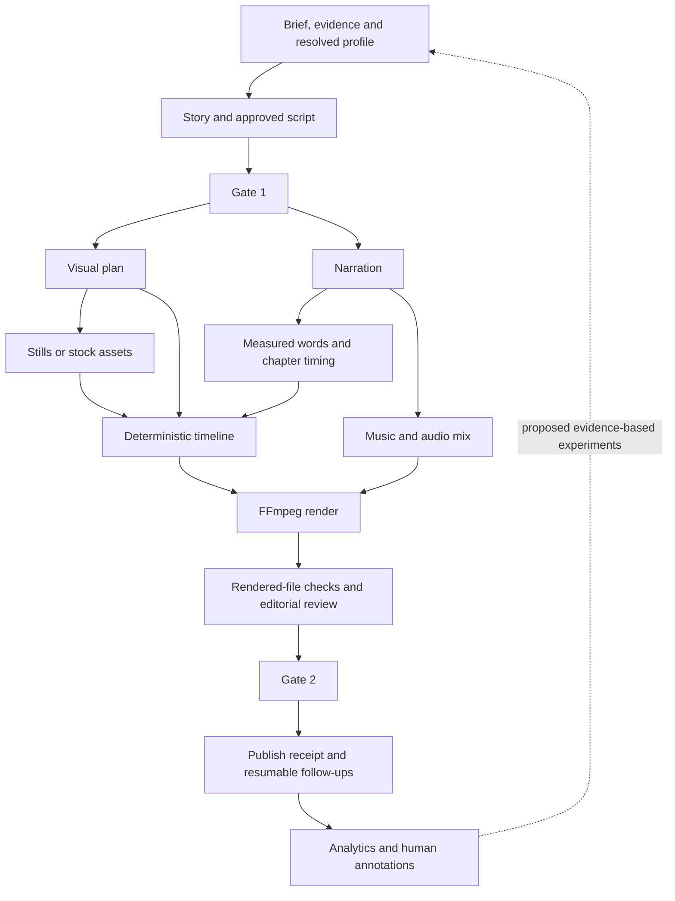

# 7AI: repository reality and a practical production-quality strategy

Audit date: **14 October 2026 (Asia/Calcutta)**. Scope: the supplied brief, sections 1–9 and the available beginning of section 10. The attachment ends at “Visual Planner: Converts”; no unseen continuation is assumed.

**Decision:** retain Fastify, React Native, PostgreSQL/Prisma, the existing stage machine, provider boundaries, FFmpeg, and both review gates. First repair contracts and recovery guarantees; then improve evidence, visual meaning, and narration through controlled comparisons. A larger agent fleet or YouTube-category production engine is not justified by the inspected evidence.

## Reading the evidence

- **Verified—code** means the implementation was inspected. It does not mean deployed, exercised against a real provider, or proven to improve audience response.
- **Verified—test/measurement** means this audit executed the stated check. Mock tests validate application behavior, not provider quality.
- **Reported** means an existing report records the result; this audit did not reproduce it.
- **Inferred** means a consequence or hypothesis supported by the evidence, with its uncertainty stated.
- **Proposed** means future work, including every new threshold or experiment below.

Each major recommendation explicitly separates those categories. Evidence references E01–E30 resolve to source files and documents at the end.

### Snapshot and limitations

The checkout changed while being inspected. It began on `provider-capacity-recovery`, HEAD `659c9e9`, with existing uncommitted recovery/planner work. Other work then produced `5af59b6` (bounded planning), merge `ea5bd5f`, `8970f59` (capacity recovery), and final inspected HEAD **`ac9a98a30cab3c7fdd367c3864960b7aa5917477`**. The report incorporates those commits. They were not made by this audit. No application code, settings, credentials, database, or published content was changed by this audit.

The status entry point is `docs/STATUS.md`, not a literal `docs/status/` directory. It is dated October 11 and trails October 13–14 implementation. Architecture is in `docs/design_doc/` and `docs/decisions/`; implementation evidence is in `docs/execution/{week*,sprint*}/reports/`; actual known content failures are in `docs/review_tuning/`. These are different evidence classes, not interchangeable truth sources.

Recent Codex chats were discoverable, including **Fix long-form planner token cap** and **Define recovery retry safeguards**. Their full histories could not be fetched: the app returned `thread/items/list is not supported yet`. Their summaries were used only to identify relevant work; local source, reports and commits establish implementation.

No live PostgreSQL, preview VPS, YouTube account, R2 bucket policy, or paid generation was exercised. No complete newly rendered long-form film was watched or listened to. Production deployment, migration application, current channel configuration, actual account quotas, current regional YouTube-category membership, audience retention, and current voice naturalness remain unverified.

### Checks actually performed

| Check | Result | What it establishes |
|---|---|---|
| Selected 14 Vitest files covering profiles, duration, long script/planning/narration/rendering/subtitles, audio, quality, retry and plan recovery | **154 passed; 1 failed**, 155 tests | Strong local coverage of the selected mechanics; not an end-to-end production certificate |
| Failed test | `long-form-quality.test.ts:144`, expected chapter-frame wording | Prompt regression. The separate false claim that stills are generated video is verified by reading the prompt and renderer; the string assertion alone does not prove an audiovisual failure |
| TypeScript `tsc --noEmit` | **Passed** | Current Studio source typechecks |
| Existing `task8-wilma/1.mp4`, dated October 6 | 27.10 s; 1080×1920; H.264, 30 fps; AAC 48 kHz, about 192 kbps | A historical Shorts artifact, not evidence for the latest long-form implementation |
| Full-file FFmpeg audio measurement of that sample | **−14.1 LUFS**, **−1.5 dB true-peak readout**, 3.9 LU loudness range | Existing mastering can meet the repository's target; it does not measure intelligibility or emotional delivery |
| Extracted contact sheet | Recurring human subject changes visibly across shots; captions are visible | A concrete continuity problem in this sample; prevalence across the corpus remains unknown |

Logs and extracted evidence are beside this report: `targeted-tests-retry.log`, `typecheck.log`, `sample-probe.json`, `sample-loudness.log`, and `sample-contact-sheet.jpg`. The initial sandbox test run failed on temporary-module ENOENT errors; the permitted rerun above is the meaningful result. Tests used an intentionally unusable database address; provider behavior was mocked/stubbed. Real local FFmpeg operations were used by some tests.

## 1. Current Project Reality

### Implemented and verified within the scope above

| Capability | Evidence and boundary |
|---|---|
| Separate Shorts and long-form rules | E02: Shorts explicit choices 30/45/60 s, default 45; long-form requests 2–15 whole minutes, default 10. These are 7AI limits, not a statement of YouTube's maximums. Resolver/duration tests passed. |
| Versioned channel profiles and per-run selection of a version | E03: `ChannelProfileVersion`, `PipelineRun.profileVersionId`, schema/resolver/load path. Resolver tests passed. Existing profiles already cover script, visuals, audio, packaging and offered formats. |
| Chaptered long-form scripts | E04: 3–6 chapters, at least 25 words each, 155 words/min target; two length repairs; a remaining large miss is flagged. Mock tests passed; dramatic quality is unproven. |
| Bounded long-form planner and recovery work | E05/E06: maximum 12 scenes per batch, 8,192-token call budget, adaptive splitting on truncation, fixed narration anchors, partial planning checkpoints and validated complete-plan reuse. Selected planner/recovery tests passed. **Do not re-propose this as missing.** |
| Actual narration drives long-form timing | E07/E08: audio is probed, Whisper words are offset per chunk, scene anchors locate words, integer frame allocation avoids cumulative rounding drift. Tests passed. Missing anchors can still be interpolated. |
| Reuse of completed long-form work | E07/E08/E09: narration and transcription caches, prompt/model/size/quality image keys, chapter segment hashes and atomic chapter rename. Tests establish some reuse paths, not atomic agreement between provider billing, files and database. |
| Audio mastering | E10: bed leveling, narration sidechain ducking, two-pass loudness workflow, stereo output and tail fade. Audio tests and the historic MP4 measurement support this. |
| Rendered-file technical review | E11: ffprobe plus FFmpeg loudness/scene analysis; checks resolution/fps/audio/loudness/duration and opt-in long still pacing. Tests passed except the separate prompt wording assertion. |
| Recovery classifications | E06: provider capacity, exhausted throttling and spend-limit cases are distinct from ordinary processing failures in the current code; completed plan reuse and retry behavior have focused mock coverage. |

### Implemented but not sufficiently verified

| Capability | Evidence and missing proof |
|---|---|
| Entire 2–15-minute production and app review journey | E01/E12 record a real short long-form run, a manual Gate 1 workaround due to a local migration gap, and later length work. Current 10/15-minute restart-to-publish verification was not reproduced. |
| Human approvals and publishing safeguards | E13/E14 implement approval checks and cancellation guards. Optional gate auto-approval also exists: Gate 1 can be disabled, Gate 2 disabling is restricted to private defaults. This differs from an unconditional two-human-gate interpretation of the brief. Actual channel toggles were not read. |
| YouTube upload recovery | E14/E15 contain a durable upload-ID checkpoint and narrow network retry rules. The checkpoint is late; overlapping and ambiguous uploads remain a concrete reliability concern. |
| Image-model migration | E16 selects `gpt-image-2.5-flare-2026-09-08`; E12 reports contact-sheet approval and real image measurements. Latest server deployment and new production output remain unknown. No need to migrate away from 1.5 again. |
| Performance analytics | E17 collects Data API counts, retention curves and long-form metrics, with failure isolation. Scope requests now include analytics; older “not enabled” notes do not prove today's account state. Need successful live responses and populated snapshots. |
| Storage persistence and cleanup | E18/E19 implement local runtime paths, R2 copies and terminal work-file cleanup. Deployment documentation places runtime storage under `/var/lib/7ai/`; source resolves `studio/data`. A mount/symlink or equivalent deployment mapping must be verified. |
| Cost limits | E20: metered usage, weekly gates and long-form per-run stops exist. They check booked expenditure, not a universal strict reservation before every billable operation. Existing estimates lag the newer planner shape. |
| Tenant/security and licensing controls | E21 includes tenant checks, encrypted channel tokens and signed media access. Music has license metadata/checks. These are mechanisms, not an independently verified security review or license attestation. |

### Planned or partially implemented

Research retrieval and claim-level evidence verification; beat-aware multimodal direction; maps/diagrams as renderable scene types; explicit character references; scene-specific repair across the full media dependency graph; narrative music cues/ambience/SFX; automated learning and topic strategy. The inspected production plan does not express most of these capabilities. Trend discovery, competitor intelligence, predictive selection and continuous-learning agents remain design work in E22; basic analytics, repeat-topic warning and human post-hoc tags already exist.

### Unknown or contradictory

1. **Status versus implementation:** October 11 status lists long-form, image move and run-screen work as future/in-flight; newer source/reports/history contain them. Deployment is a separate unknown. E01/E12.
2. **Planner/reviewer versus renderer:** prompts request or assume Runway/Hunyuan-style moving clips; long-form explicitly requires AI stills, and FFmpeg supplies pan/zoom. E05/E08/E11/E23.
3. **“Research sources” versus evidence access:** sources are short strings; no retrieval tool is attached to the LLM client. Long-form writer receives the strings, Shorts writer does not append them in that path, and reviewer input has no sources field. A URL is not fetched evidence. E04/E23/E24.
4. **“Safe to retry” versus upload timing:** the stall guard leaves the original operation running; upload-ID persistence happens after follow-up work. E14/E15.
5. **Voice enum versus actual model:** 13 voices are selectable in E25; official documentation lists a smaller set for `tts-1-hd`. `ballad`, `verse`, `marin`, and `cedar` need capability validation before this model can accept them. This is a documented compatibility risk, not a live reproduced API failure. [Official speech guide](https://developers.openai.com/api/docs/guides/text-to-speech).
6. **Long pacing is no longer absent:** commit `9384413` already made excessive long still holds a regeneration signal. Its usefulness and false positives on real films remain unvalidated. Do not repeat the older report's claim that nothing flags long holds. E11/E12.

## 2. What excellent means: a scorecard with separate gates

The following is a **proposed evaluation policy**, not an empirical claim that any numeric threshold maximizes retention. Keep the dimensions separate. Technical validity and factual integrity cannot be compensated by high aesthetic scores.

| Dimension | Observable test | Proposed minimum / review responsibility |
|---|---|---|
| Narrative | Opening promises a specific question/outcome; each chapter changes understanding or stakes; ending addresses that promise | Two reviewers can state the promise and payoff in one sentence; no major unresolved promise unless honestly framed as unresolved evidence. Score 1–5, minimum 3 |
| Educational value | Claims have supporting excerpts; numbers/names/dates and qualifiers survive adaptation; explain causal steps | No material unsupported claim presented as fact. All central claims traceable. Human checks interpretation and omissions; deterministic number/name comparisons only flag, never prove truth |
| Visual storytelling | Shot matches the spoken concept; recurring subjects/places remain coherent; graphics explain spatial, quantitative or temporal relationships | No material misleading shot; important explanation is actually visible. Score minimum 3; annotate mismatch intervals |
| Audiovisual immersion | Accurate pronunciation; natural phrasing; no buried words; music changes or silence have a reason | No unintelligible sentence or material mispronunciation. Existing technical targets plus listening on headphones and a phone; score minimum 3 |
| Audience experience | Viewers can retell the central explanation and identify confusing, repetitive or slow moments | No unresolved major confusion; score minimum 3. Use comprehension questions and blind preference before claiming watch-time benefit |

**Keep the existing technical floor:** appropriate 1080×1920 or 1920×1080, 30 fps, audio present, measurable loudness; aim for −14 ±1 LUFS with current hard band ±3; true-peak target ≤−1 dBTP, complete decode, expected caption/subtitle behavior. The repository treats several codec/peak/caption findings as warnings, so do not describe them as current hard gates. Proposed additional blockers: undecodable media, missing mandated checks, malformed subtitles, and clear clipping; calibrate against clean fixtures before enabling.

Long duration requests and actual media bounds are distinct: E11 accepts approximately 96–918 s for long-form and a narration/video gap ≤2%; target-duration misses are separately surfaced. Preserve that distinction instead of forcing narration into a target by time stretching.

Editorial scores should attach reasons and time intervals, not an unexplained average. Record disagreements. The model can suggest concerns; only calibrated deterministic checks should decide technical facts, and humans should judge nuance, evidence sufficiency and emotional effectiveness.

## 3. End-to-end execution and dependency map

Common contracts: `PipelineRun` owns status/options/profile reference; `PipelineStage` stores input/output and attempt number; `UsageEvent` stores provider/model/usage/cost; `ReviewLog` stores decisions and approver identity. JSON stage outputs are the practical extension point. Database schema existence does not establish applied production migrations. E03/E13/E20.

| Stage | Current inputs → outputs/tools | Validation, persistence, failure/reuse and quality implication |
|---|---|---|
| 1. Channel/brief | Channel + selected profile + explicit picks → resolved config and intake topic/constraints; Haiku | Zod/API checks; run captures profile version/options. No active-profile replacement mid-run; some legacy/default/format values are still resolved from current code. E02/E03/E24 |
| 2. Research | Brief and `sources` strings | No fetched evidence bundle/claim ledger in inspected call chain. Missing retrieval is not repaired by reviewer confidence. E23/E24 |
| 3. Story/script | Topic, constraints, guide, format → Shorts narration/captions or long chapters/hashtags; Sonnet | Schema decoding and parse repair; long length repair; calls metered and completed stage persisted. No separately verified story-beat contract. E04/E24 |
| 4. Script review/revision | Script + brief/niche/style → score, hook notes, factual concerns, fit flags; Haiku | Score <7 triggers bounded automatic rewrites, then human review. No source excerpts in reviewer input. Existing factual-miss corpus is valuable regression material. E23/E26 |
| 5. Gate 1 | Draft + review → sanctioned script, human edits/reject/approve | Durable stage/review records and restart reopening; chapter edit parsing. Gate can be configured to auto-approve. Approval should bind to the specific sanctioned text. E13 |
| 6. Visual planning | Sanctioned text/config/revision notes → `ProductionPlan`; Sonnet | Shorts choose stock/stills, style, queries, still prompts, mood. Long-form batches still scenes by chapter, stores anchors/checkpoints. Timing prose is not authoritative media timing. E05/E06/E27 |
| 7. Assets | Prompt → OpenAI image; query → Pexels clip (Shorts) | Image usage priced; per-image 429 retry; moderation refusal skips image, long-form fills from a neighbor. Long has disk cache; Shorts uses a different path. No current generated-video backend. E09/E16/E27 |
| 8. Narration | Sanctioned text + voice → MP3; `tts-1-hd` | API receives model, voice, input and MP3 format, no delivery instructions. Long chunks at sentence boundaries around 4,000 characters; caches paid work, probes audio. E07/E25 |
| 9. Timing/transcription | Audio → Whisper word timestamps | `verbose_json`, word granularity; long per-chunk offsets and size guard. Captions realign approved words. Transcription is not equivalent to proven perfect forced alignment. E07/E25/E28 |
| 10. Timeline | Words/chapters/scenes → frame schedule | Long finds first three normalized anchor words, interpolates unmatched anchors; fixed anchors now cover each chapter. Shorts distributes images over caption/word windows without explicit semantic scene anchors. E08/E27 |
| 11. Music/mix | Voice + chosen mood track(s) → normalized mix | Curated manifest, license checks, ducking; long chains/crossfades tracks then loops last. One global mood, not story-specific cues; no general ambience/SFX implementation. E10/E29 |
| 12. Render | Images/clips, timeline, mix, captions/watermark → MP4 | FFmpeg H.264/AAC; Shorts burns ASS, long emits SRT separately. Long chapter segments reusable; final mux probed. Encoding success is necessary, not sufficient. E08/E27/E28 |
| 13. Video review | Actual MP4 + script/topic → metrics + pass/fail and fix notes | Full-file technical measurements; sparse images to Haiku, not complete audiovisual watching. Long samples chapter midpoints, capped at 12. Failed review triggers bounded regeneration; exact creative correctness is not assured. E11 |
| 14. Gate 2 | Passing review + preview/subtitle links → approve/revise/reject | Long preview/SRT prepared before gate; approval records exist. Private gate-skip exception exists. Regeneration should require approval again for a changed artifact. E13/E30 |
| 15. Publish | Approved output + Haiku metadata → YouTube ID, thumbnail/caption outcomes | Checks Gate 2 approval and sanctioned script; multipart upload; narrow safe automatic retry. Late durable receipt creates risk. Follow-up failures mostly isolated. E14/E15 |
| 16. Analytics | Published video ID → counts, retention curve, long metrics | Initial + periodic snapshots; per-channel auth failure isolation. CTR is not filled by the current long metrics structure. No autonomous optimization established. E17 |
| 17. Storage | Runtime files + drafts/finals/bundles → disk and optional R2 | Local paths remain important for recovery; R2 is additive. Terminal cleanup removes cached work; needs-attention should retain it. Deployment path mapping/backup recovery unverified. E18/E19 |
| 18. Lifecycle/budget | State, attempts, spend → continue/backoff/pause/cancel | Restart handling and specific recovery markers exist; in-memory cancellation/driver tracking is not a cross-process lease. Long guards stop between paid steps. E06/E13/E20 |
| 19. Diagnostics/evaluation | Logs, stage history, usage, quality rows, bundles → operator evidence | Useful engineering telemetry already exists. Lacks a demonstrated golden-film evaluation set linking changes to viewer outcomes. E11/E18/E20/E26 |

**Invalidation rule, proposed:** a factual/script change invalidates narration, its alignment, dependent timeline and final approval; a single visual replacement invalidates its chapter render and final review, not unrelated audio; a music change invalidates mix, mux, loudness and final review; a thumbnail/subtitle upload retry must never invalidate the successful video upload. Store dependency hashes so reuse is an explicit decision. Never overwrite the user-approved artifact while a revision is being prepared.

## 4. Prioritized recommendations

Effort estimates below are **planning estimates for one engineer familiar with this codebase**, excluding provider approval, editorial labeling and production observation. They are not delivery commitments.

### R1 — Close the publish receipt and overlapping-upload gaps first

**Verified:** E14 receives `uploadResult` at line 1959, runs R2 final upload, cover-frame/thumbnail work and long-form captions, then checkpoints the ID at line 2063. Resume reuse also requires the attempt still to be `running`. E15's stall guard explicitly does not cancel the original operation, yet tells the operator retry has no duplicate risk. The upload client correctly avoids automatic retries for ambiguous remote outcomes; that useful safeguard should stay.

**Inferred:** a process death during those follow-ups can lose knowledge of an already created video. A stall followed by manual retry can overlap the original request before either has a receipt. These are code-path failure scenarios; no duplicate was intentionally created to demonstrate them.

**Proposed:** persist the successful upload receipt immediately, before any follow-up await; reuse the receipt regardless of whether the surrounding stage later failed. Make thumbnail, R2 copy and caption operations independently resumable. Persist upload-in-progress ownership and prevent a second uploader while the first outcome is unknown. Bind the receipt to run, approved artifact hash and upload metadata. Replace the unconditional “safe” wording with the actual state. Then adopt the existing provider's resumable protocol, persisting the session URI before bytes are sent. Session expiry or an unrecoverable ambiguous outcome must request reconciliation, not start a new upload automatically. This is an incremental change to the current publishing boundary, not a new scheduler.

**Acceptance:** inject a crash after remote success, during each follow-up, after receipt persistence, and before stage completion; every resume calls `videos.insert` at most once for the known successful upload. Two concurrent drivers and a stalled operation must not launch two uploads. Confirm missing approval/failed required validation blocks upload. Exercise resumable status-query/expiry scenarios using a fake server, then one authorized private production validation. Estimated 3–6 days for receipt/ownership work; another 3–5 for robust resumable integration. [Official resumable protocol](https://developers.google.com/youtube/v3/guides/using_resumable_upload_protocol).

### R2 — Make prompts describe the production system that actually exists

**Verified:** E05/E23/E11 describe moving generated clips, while E08 accepts stills only. E04 hardcodes historical documentary style, a 50–100-word tension opening, historical search terms and unresolved template placeholders. At its own 155 words/min estimate, that opening occupies about 19–39 seconds. E11's reviewer is told to fail only extreme visual problems, limiting its usefulness for educational relevance. The selected suite has the related wording regression.

**Inferred:** the planner spends output tokens on physically impossible directions for a still renderer, and strong system-level history instructions can conflict with science/biography channel guidance. Changing models before correcting these contracts would make evaluation hard to interpret.

**Proposed:** use truthful format-specific prompts: still composition plus the actual supported render movement; stock clips only where supported. Repair the template interpolation, remove universal history assumptions, and let existing niche/guide/format inputs supply creative direction. Require one clear visual purpose and narration anchor per scene. Keep the new batching/recovery implementation. Do not increase the token cap simply because Sonnet supports more output. Update prompt tests to assert the capability contract and fully rendered constants, not only incidental wording.

**Acceptance:** identical briefs across five niches produce valid plans with no nonexistent media claims; zero unresolved placeholders; no unsupported renderer command; fewer truncation/repair calls than the recorded baseline; blind reviewers prefer relevance and comprehension without sacrificing factual correctness. First fix 1–2 days; evaluation with actual rendered samples 2–4 additional days. No new model or agent.

### R3 — Give the writer and reviewer the same evidence, then evaluate claims

**Verified:** E24's model call has no browsing/retrieval tools. E04 appends source strings only for long-form; E23 does not receive them. E26 documents repeated invented claims and overconfident scores, including failure of a facts-only instruction. The long-form Task 9 report also records added facts that passed review.

**Inferred:** a polished script can pass the existing score threshold despite being ungrounded. Source URLs displayed in the app or description can create a false impression of verification. Prompt-only fact restrictions are demonstrably insufficient in the reported cases.

**Proposed:** begin with a compact, human-supplied evidence bundle using source ID, locator/URL, excerpt, access date and a claim/qualifier. Feed the same bundle to writer and reviewer for both formats. Record important narration claims against evidence IDs, with `supported`, `interpretation`, `disputed`, or `unsupported` status and an explanation. Keep this inside existing stage data/review, not a separate agent. Flag unmatched dates/numbers/names deterministically, but use semantic review for causality, paraphrase and hedges. A missing central fact should lead to a narrower script or a request for evidence, never invented padding to hit length.

**Acceptance:** build labeled regressions from E26, including accurate paraphrases, preserved hedges, source-supported additions, unsourced causal claims and contradictory excerpts. Measure material-error recall and false alarms separately. Proposed release condition: no missed material error in the small regression set, and no unexplained rejection of valid controls; expand before treating this as a production guarantee. At Gate 1 show unresolved claims individually. A later retrieval module is justified only if manual sourcing is a measured bottleneck, with provenance, redirect/security checks, fetch limits and failure states. First bundle/review integration 3–5 days; trustworthy automated retrieval is separate scope.

### R4 — Improve semantic alignment and continuity before buying moving clips

**Verified:** E08 matches only the first three normalized anchor tokens and interpolates unmatched positions; new E05 anchors distribute across the chapter deterministically. E27's Shorts images are allocated by timing windows without a narration-to-image semantic contract. The historic contact sheet shows substantial subject appearance changes and a childhood-style shot under a later achievement caption. E09 substitutes neighboring images when a long-form prompt is refused. No reference-image continuity path appears in the current `images.generate` call.

**Inferred:** some scenes are technically well timed but communicate the wrong event or identity; global re-generation can pay for many acceptable scenes to repair one failure. Evenly spaced anchors reduce extreme holds but do not establish narrative beats.

**Proposed:** persist a scene's approved narration span, purpose, subject/reference ID and actual asset ID. First validate exact span occurrence/order and report interpolation explicitly. Associate reused/refused assets with a visible scene-level warning. Add contact-sheet review grouped by recurring subject and chapter. Introduce deliberate motion choices with focal point only when the renderer uses them; do not add an unconsumed cinematography vocabulary. Prefer symbolic objects, locations and documents over an invented exact likeness when identity cannot be maintained.

**Acceptance:** label 20 difficult scene boundaries with repeated phrases, names, pauses and refusals. Proposed trial target: every central scene maps to the intended passage; p95 start error ≤300 ms on hand-labeled boundaries where a precise cut is intended; maps/slow reveals can specify deliberate offsets. Review all recurring-character shots for unacceptable changes. Repairing one image must preserve unrelated narration/assets, rerender affected segments and require final review. Estimate 4–7 days for span diagnostics and targeted visual replacement; reference-image generation is a later tested adapter extension.

### R5 — Extend final-file checks and direct repairs to the failing component

**Verified:** E11 already measures the real MP4, including audio and cuts. Sparse sampled frames cannot establish motion coherence or narration naturalness. Caption detection uses contrast in a region, not text recognition or reading-order validation. True peak and some quality rows are warnings; long still pacing is already an enforced option. E08 uses scene-index motion patterns, not story-dependent direction.

**Inferred:** a long map, similar-image cut, quiet pause, blank interval between samples or audible edit can evade or confuse the current review. A global longest-shot threshold can penalize a legitimate explanation. Regenerating imagery to fix clipping or a deterministic layout problem wastes money.

**Proposed:** keep the current metrics and add full decode validation, bounded black/freeze/silence interval scans, SRT parse/time/text coverage, and actual scene-asset mapping. Sample each scene and discontinuities for visual checks, while giving human review prioritized suspect intervals. Classify failures by repair: audio-only remaster, timing-only rebuild, subtitle correction, image-only replacement, or script reapproval. Add an intentional-hold reason for maps/diagrams only when those scene types ship; until then tune the still gate against measured false positives.

**Acceptance:** corrupted/truncated video, missing audio, accidental long black/silent span, wrong subtitle content and known image mismatch fixtures must be detected; intentional black fades, diagram inspection and deliberate silence must not be blindly rejected. A repair must produce new final-file measurements. Estimate 3–6 days. FFmpeg already offers relevant analysis filters; use it before adding an evaluator model. [Official filter reference](https://ffmpeg.org/ffmpeg-filters.html).

### R6 — Preserve recovery assets and make costs/restarts auditable

**Verified:** E06 already distinguishes recovery kinds and reuses valid plans. E09 writes image bytes before a usage callback; E07 writes cache metadata before the database-cost callback. A process can die between those operations. E20 estimates 80 planner output tokens per image while the current prompt requests 80–140 words per image and now repeats context across batches. Its “worstCaseUsd” assumes stills are paid once, which is not guaranteed when revision changes prompts. Booked-spend checks happen after paid operations. E18 uses `studio/data`, while deployment claims external runtime storage. E19 deletes resumable work at terminal status but retains final videos. Cancellation of an actively driven run is initially in memory (E13).

**Inferred:** current normal retries can work well while rare interruption windows under-record costs or accept incomplete cache files. A budget stop is not a strict financial maximum; one billable call may cross it, and concurrent runs share budget. A cancel followed immediately by process death can lose the request. Moving to multiple workers without leases would enlarge these risks.

**Proposed:** finish validation of the new recovery work before further redesign. Atomically write asset receipts and completion markers; validate decode/checksum before reuse; reconcile durable receipts into idempotent usage records. Include prompt/model/render version in cache invalidation where changes affect output. Persist cancel intent and check it before starting additional paid units; let in-flight operations reconcile their outcome. Verify the deployed persistent mount includes videos, narration, image cache and debug artifacts. If it does not, use one explicit runtime-root setting because restart survival is testable; keep fonts/music as application assets. Preserve final approved files, evidence and run manifests independently of temporary caches.

Update estimates for batch context, actual prompt size, metadata/review, possible changed-image retries and CPU/storage costs. Rename a scenario estimate if it is not a mathematically valid worst case. Show uncertainty. If `maxCostUsd` must be a hard cap, reserve a conservative per-call allowance atomically before dispatch; otherwise label it a stop-after-booked-spend limit. Do not promise exactly-once billing where the external API gives no idempotency or receipt recovery.

**Acceptance:** process-kill tests around provider return/file rename/receipt write/cost write; missing/corrupt asset recovery; repeated capacity pauses; cancel/restart; disk-full; two concurrent budget reservations; deploy/rollback with an unfinished run. Cached valid assets produce zero additional generation calls. Cost rows reconcile to available provider receipts, with unknown remote outcomes explicitly marked. Estimate 4–8 days, split into independent changes. No new broker until multiple workers are actually required; add a PostgreSQL ownership lease before that scale-up.

### R7 — Fix voice compatibility and plan the required audio lifecycle transition

**Verified:** E25's voice enum is wider than documented `tts-1-hd` support. The API call ignores delivery instructions/speed because it only sends voice/text/format. Current speech instructions do not work on `tts-1-hd`. Official documentation checked today schedules `tts-1-hd` shutdown for **January 6, 2027** and `whisper-1` for **February 26, 2027**. These dates, unlike aesthetic model rankings, create a concrete reliability reason to plan replacement. [Speech API](https://developers.openai.com/api/reference/typescript/resources/audio/subresources/speech/methods/create), [deprecation notice](https://developers.openai.com/api/docs/deprecations).

**Inferred:** adding a “dramatic delivery” setting to the present call would be misleading unless script punctuation or a supported speech parameter actually implements it. A replacement transcription model without the required word-timing contract would break alignment and captions even if its text accuracy improves.

**Proposed:** immediately validate voices against the selected model; preserve old approved audio. Compare existing TTS with improved punctuation/pronunciation and mix first. In parallel prepare a speech-adapter migration for the announced retirement. The notice recommends `gpt-realtime-2.1-mini`; evaluate its session handling, file assembly, repeatability, content fidelity and actual usage billing before selecting it. The speech guide still features `gpt-4o-mini-tts`, while dated snapshots also appear in the deprecation notice: resolve the exact supported model/API combination at implementation time instead of making a one-line registry swap.

For transcription, evaluate the documented successors only with a proven way to produce the word alignment 7AI needs. A local forced aligner is a conditional fallback if the successor does not meet that contract; its installation, language coverage and operating cost need an experiment. Do not replace Whisper solely because another recognizer is newer.

**Acceptance:** use the same approved passages: historical names, numbers, emotional shift, quiet explanation, multilingual sample if supported, long chapter boundary. Blind tests compare intelligibility, pronunciation, naturalness and exact content preservation; measure timing error, p50/p95 latency, failure rate and all billed usage. Proposed minimum: no dropped/invented words or material name errors in the acceptance corpus, no regression in alignment/technical floor, and a documented rollback while the old API remains available. Estimate 1 day for capability validation; 1–2 weeks for migration spike/integration and editorial testing. A delivery field is added only if this trial shows benefit and the adapter consumes it.

### R8 — Prototype explanations and sound cues inside the existing plan

**Verified:** current visuals are stills or stock, movements alternate by index, and audio uses one mood with track chaining. There is no general map/timeline/diagram renderer or beat-specific sound-cue execution. Existing audio mastering is already effective in the measured sample. E08/E10/E27/E29.

**Inferred:** a map showing a boundary, a chronology showing causality, or one well-placed silence may improve understanding more than another beautiful reconstruction. This is a creative hypothesis, not a measured retention improvement.

**Proposed:** add one deterministic graphic type first—an annotated timeline or simple verified-location map—with reproducible labels/data and a narration span. Add a small chapter/beat music cue list supporting `none`, existing mood and transition; first experiment with silence or a restrained change in intensity. Preserve automatic ducking/normalization. Licensed ambience/SFX follow only when their absence is identified by review. Never play invented historical sound as evidence of an actual recording.

**Acceptance:** a paired 60–90-second sequence, identical narration/evidence, compares current stills against one explanatory graphic and one deliberate sound transition. Test factual recall, relationship comprehension, perceived clarity and preference; measure render success and extra edit time. Keep it only if reviewers consistently prefer it and comprehension does not decline. Estimate 3–5 days for one graphic primitive; 2–4 for minimal cue execution. Generated video stays an experiment for one high-value shot, not a default backend.

### R9 — Establish a small editorial benchmark and use analytics as evidence

**Verified:** E17/E26 already provide performance snapshots, post-hoc tags and a useful factual-miss corpus. They do not demonstrate that a particular prompt, model or visual style improves retention. No automatic profile-learning loop was established.

**Inferred:** optimizing an LLM's score or treating a few high-view videos as causal evidence can reward confident factual errors and topic popularity rather than better production.

**Proposed:** curate 12–20 approved briefs spanning five niches and both formats, including 2-, 10- and 15-minute long-form boundary cases. Start experiments with short excerpts, then promote winning changes to complete films. Store baseline/candidate artifact hashes, profile/prompt/model versions, spend, elapsed time, failures and timestamped human notes. Use blinded order and at least two reviewers. Link retention drops to scene/chapter timestamps when live analytics are confirmed; compare similar topic/length/audience windows, report sample sizes and uncertainty. Let humans approve profile changes. No autonomous learning agent is needed for this phase.

**Acceptance:** each proposed change identifies a failure it should fix, preserves factual/technical minimums, and beats or matches baseline on declared measures. A pragmatic pilot threshold is a ≥0.5-point improvement on the targeted 1–5 dimension plus preference on at least 8 of 12 paired sequences; this is a screening rule, not statistical proof. Follow with more samples and confidence intervals. Estimate 2–3 days for harness/reporting; editorial labeling and publishing observation are ongoing work.

## 5. Existing models and services: use them deliberately

### Current configured model inventory

Prices below were checked against official pages on **14 October 2026**. They are unit prices, not an account invoice or a guaranteed per-video quote.

| Configured model | Actual responsibility / output | Current limits, pricing and decision |
|---|---|---|
| `claude-sonnet-5` | Script generation; video production planning | Repository $2 input/$10 output per million tokens matches official pricing. Official 1M context/128K output; application caps remain 4,096 for Shorts script, 12,000 long script, 8,192 per long planning batch. Retain while fixing contracts; do not increase limits indiscriminately. [Model documentation](https://platform.claude.com/docs/en/models/sonnet-5/overview) |
| `claude-haiku-4-5` | Intake, script review, sampled-frame video review, publishing metadata | Repository $1/$5 per million input/output tokens matches official documentation; 200K context/64K output. Application calls are much smaller: script review 1,024/2,048 and video/metadata 512 tokens. Retain unless labeled failure detection shows a stronger reviewer earns its cost. [Model documentation](https://platform.claude.com/docs/en/models/haiku-4-5/overview) |
| `gpt-image-2.5-flare-2026-09-08` | Low-quality-setting generated stills; portrait/landscape | Dated snapshot verified in official model page. Repository rates: $5/M text input, $8/M image input, $30/M image output; $0.005 fallback if usage missing. Reported low-quality still about $0.0049 is a particular measurement, not a universal price. Keep migrated model; test medium quality only for shots that need it. [Model](https://developers.openai.com/api/docs/models/gpt-image-2.5-flare), [pricing](https://developers.openai.com/api/docs/pricing) |
| `tts-1-hd` | MP3 narration | $30 per million characters; voice/text/MP3 only today. Retain approved artifacts, fix voice compatibility, plan retirement migration under R7. [Model and price](https://developers.openai.com/api/docs/models/tts-1-hd) |
| `whisper-1` | Per-word transcription/alignment input | $0.006/minute; current call requests word timestamps. Preserve that contract through its planned retirement. Official file guide supports this usage, 25 MB chunks, and warns that timestamp granularity is specific to Whisper's API. [Model price](https://developers.openai.com/api/docs/models/whisper-1), [file transcription](https://developers.openai.com/api/docs/guides/speech-to-text) |

The model names in registry comments, historical reports and design documents are not additional active routes. Runway/Hunyuan are prompt references, not integrated providers. No runtime fallback LLM provider was found: E24 resolves Anthropic, with application-level structured-output fallback/repair rather than an independent model fallback. A provider outage should pause/recover with existing artifacts, not silently change creative behavior.

Other inspected dependencies: **Pexels** stock search/download for Shorts; **YouTube Data API** upload/metadata/captions/statistics; **YouTube Analytics API** retention/long metrics; **Google OAuth** per-channel identity; **Cloudflare R2 via S3-compatible SDK** drafts/finals/bundles/signed access; **Telegram and Expo push** operator notification paths; **PostgreSQL/Prisma** durable records; **FFmpeg/ffprobe and bundled font/music assets** deterministic production. None is evidence of a complete research or learning service. Account access and paid plans were not inspected.

### Routing policy and alternatives

| Task | Recommended route | Escalation or fallback rule | Evaluation |
|---|---|---|---|
| Schema checks, timing, subtitles, math, audio/encoding validation | Deterministic TypeScript/FFmpeg | Explicit failed/unknown check; never ask an LLM to invent an authoritative timestamp | Corrupted and valid fixtures; measured output |
| Intake and packaging | Existing Haiku | Bounded repair; pause on provider failure | Schema/constraint accuracy and metadata fidelity |
| Script/story construction | Existing Sonnet + supplied evidence + channel guide | Revise affected passages; obtain evidence when missing | Grounding + narrative scorecard |
| Visual planning | Existing Sonnet, truthful still/graphic contract, bounded batches | Split output on cap; reuse completed batches; pause rather than lose paid work | Scene relevance, alignment, JSON success, tokens per approved scene |
| Script/visual criticism | Existing Haiku plus deterministic checks and human gates | Test Sonnet on the same labeled misses only if Haiku recall remains inadequate after equal evidence/context | Material-error recall, false-positive rate, cost per useful correction |
| Still generation | Current pinned Flare snapshot | Reuse exact valid assets; human-visible substitute on refusal; no unannounced identity drift | Blind visual relevance/continuity at low vs medium quality |
| Narration/alignment | Existing adapters now; bounded lifecycle migration trial | No silent model switch; rerun dependent alignment/validation after audio changes | Listening, content fidelity, timing and reliability |
| Research and performance learning | Human evidence selection + deterministic storage/reporting initially | Add retrieval only after sourcing time is measured; never rewrite defaults autonomously | Evidence coverage, research minutes, controlled content experiments |

**Option comparison:** better use of current models is the first move because verified defects are input/contract/evaluation problems. Selective specialists are justified for announced retirement or a demonstrated alignment/visual limitation, not novelty. The recommended steady state is a hybrid of existing models, deterministic production and human review. A fully autonomous multi-agent rewrite would add failure boundaries and cost without a measured benefit; a manual editing handoff for exceptional films is a sensible alternative to repeated paid regeneration.

Structured decoding is already present for scripts; it does not verify facts. The long planner still parses constrained JSON in application code. Evaluate schema decoding there only if actual parse failures persist after the new batching fix, using exact installed SDK/provider support and preserving usage on failures. Do not add temperature/effort controls generically: Sonnet 5's official documentation rejects non-default sampling settings. Batch APIs and prompt caching could reduce repeat-input cost, but should follow measured waiting-time tolerance and cache hits; they are not substitutes for reusing completed results. E04/E05/E24.

### Economic example and uncertainty

At 10 minutes, current defaults imply 1,550 words, about 9,300 characters at the estimator's six-character assumption, and 120 stills at five seconds/still. TTS is approximately **$0.279**, transcription **$0.060**, and image fallback pricing **$0.600**: **$0.939 before LLM calls, retries, review, storage and compute**. These are transparent planning calculations, not measured total cost. An 80–140-word prompt per scene can materially exceed the estimator's 80-token assumption. Repeated batch context, reasoning usage, rejected output and changed-image regeneration need actual receipts.

The code serializes image requests and handles per-image throttling; historic organization measurements cite five images/minute, while public model tier limits differ. At that historical quota, 120 new images alone require about 24 minutes of throughput. Verify current account limits and p95 latency before recommending concurrency. Measure dollars and wall time **per approved finished minute**, cache-hit ratio, rework spend, upload uncertainty incidents and the share of runs requiring intervention. A cheaper first draft that repeatedly fails review may cost more overall.

## 6. A production language that the renderer can execute

This section is **proposed design**, grounded in R2/R4/R8. It is not a claim that these capabilities exist today.

### A small scene contract

Extend the current scene gradually, rather than replacing it with dozens of cinematography fields:

| Field | Why it earns its place | Consumer/test |
|---|---|---|
| Stable scene ID and narration span | Connect meaning, timing, repair and review | Timeline, diagnostics and dependency hash; verify coverage/order |
| Purpose: establish, explain, compare, reveal, reflect | Makes a shot's contribution reviewable | Reviewer must identify the communicated fact/emotion; do not treat the label as proof |
| Asset kind + asset/reference ID | Chooses a genuinely supported renderer and preserves identity/provenance | Initially still/stock; add timeline graphic only when implemented |
| Prompt or graphic data | Describes a still or supplies exact labels/values | Provider or deterministic graphics renderer; schema and evidence checks |
| Motion/focal point | Directs a supported pan/push/hold toward something meaningful | Render path and safe-crop validation; omitted uses current behavior |
| Evidence/reference IDs where relevant | Prevents visual reconstructions being mistaken for records | Gate 2 provenance and human review |

Keep timing results, alignment confidence, frame ranges, asset checksum and actual cost in a **derived execution record**, not model-authored truth. Optional cue references can point to a small audio cue list; avoid repeating the same lighting palette, brand prose and character description in every scene. Resolve reusable references once, then include only necessary provider context.

### Duration follows comprehension and performance

The planner identifies narration spans and may express a target/intent; actual recorded words determine authoritative boundaries. The renderer rounds cumulative boundaries to frames, as long-form already does. For a map or diagram, reserve enough narrated or intentional quiet time to inspect labels; if that time does not exist, simplify the graphic or revise the script before approval rather than slowing approved audio silently.

For a reveal, align the visual change to the revealing word; for reflection, a stable image and brief silence may be correct. Dense typography must be readable on a phone. Scene duration should be assessed by purpose, complexity and the listener's task, not a universal “change every N seconds” rule. Initial experiment bands such as 2–5 seconds for simple Shorts shots or 5–12 seconds for a readable explanation are only test hypotheses; do not expose them as fixed category laws.

Detect repetition using exact asset hashes and then perceptual similarity with manual review; consecutive duplicate assets are not automatically an error if deliberately held. Detect rushed graphics through label density/available reading time and a human comprehension test. Detect disconnected visuals by reviewing the paired narration span and actual sampled image. Detect static stretches using actual asset occupancy plus motion analysis; scene-difference thresholds alone can miss a cut between similar frames or count a movement as a cut.

### Choose the cheapest visual that communicates the idea

| Medium | Likely value | Costs, latency and failure modes | Recommended use |
|---|---|---|---|
| AI still | Controllable reconstruction and atmospheric setting | Current integration, relatively low API spend; identity/historical errors, crop loss | Keep for reconstructions with evidence-aware labeling |
| Motion-enhanced still | Focus attention, reveal detail or geography in an existing composition | Local CPU/render time; can crop the subject or create mechanical rhythm | Use a purposeful hold/pan/push, not mandatory motion |
| Deterministic map/timeline/diagram | Exact chronology, geography, mechanism or numerical comparison | Initial implementation/editorial effort; bad input data or unreadable labels | Highest-priority new visual primitive for explanatory passages |
| Licensed stock/archive | Real motion, authentic places/material where provenance supports it | Search and licensing effort; wrong era/place, generic repetition | Keep Shorts stock path; prove relevance before extending it to long-form |
| Generated video | A selected action/reveal that genuinely needs movement | New API integration, variable latency/cost, temporal/identity artifacts and retries | Small isolated shot experiment after baseline; no default rollout |

No generated-video vendor price or speed is asserted here because none was selected or measured. Any trial must report total accepted-shot cost including rejected candidates, time to accepted shot, temporal defects, continuity and impact on comprehension. A still-based fallback must be editorially approved, not secretly substituted into a promised motion-dependent explanation.

### Continuity where it matters

Recurring named people, a specific room, a boundary-changing location or an object central to the explanation warrant stable reference IDs. Use a short character/location bible with stable age range, clothing, era, palette and identifying features; explicit age/time changes belong to the story. Start with textual references and contact sheets already compatible with current images. Reference-image edits are worth integrating only if paired tests show fewer identity failures. Similarity scores can triage variation; they do not establish historical accuracy or personal identity.

Exact identity is unnecessary for anonymous crowd atmosphere or a symbolic object. Do not spend regeneration budget on invisible background continuity. For mythology, coherent iconography and clearly named versions may matter more than photorealism. For documentary history, invented photorealistic images should be understood as reconstructions, with the existing synthetic-content publishing flag preserved.

### Sound as direction

Keep current bed leveling, sidechain ducking, normalization and tail handling. Add one cue at a meaningful narrative boundary: decrease intensity while explaining a complex relationship, pause before the answer, or change the musical phrase after a reversal. Narration is the master clock. Crossfade durations must fit available time; no accidental masking of the revealing word. Ambience should identify a setting without implying archival authenticity, and discrete SFX should have an intelligible cause on screen.

For example, a historical boundary story can begin with one supported human consequence, show a labeled map during the causal explanation, use a restrained push toward the boundary, reduce music under the explanation, then pause before the documented outcome. The same narration-only test should still make sense; the graphic should add measurable understanding. This is a proposed sequence, not a prescription for every historical video.

## 7. YouTube categories versus niche production profiles

### Recommendation: no category-level creative engine

**Verified:** `packaging.categoryId` already exists and is passed into YouTube upload. Long-form defaults to `27` (Education) in repository code. Existing profiles already control the creative fields listed below. Google's API returns categories via `videoCategories.list(part=snippet, regionCode=...)`; each item has an ID/title and `snippet.assignable`. These are platform metadata properties, not production instructions. [Category listing](https://developers.google.com/youtube/v3/docs/videoCategories/list), [category resource](https://developers.google.com/youtube/v3/docs/videoCategories).

**Inferred:** broad classifications such as Education, Science & Technology, Entertainment, and People & Blogs cannot distinguish a myth retelling from a documented mystery or a calm explainer from a suspenseful biography. Adding a full creative layer for those categories is more likely to produce conflicts than a useful creative vocabulary. No measured category-to-quality benefit was found.

**Proposed:** keep YouTube category in packaging, validate it against assignable regional options, and offer **small reusable niche presets using the existing channel-profile structure**. A preset is initially an authoring aid that creates a normal profile version. It does not become a continuously inherited setting that silently changes old channels. Add runtime niche inheritance only if maintaining multiple channels demonstrates enough duplication to justify it.

**Unverified:** this audit did not obtain an authenticated current regional category response, so it does not claim a complete current list of options or validate every sample label/ID. The repository's Education mapping is verified as application behavior, not a live API enumeration. The required implementation evidence is a cached successful `videoCategories.list` response for the intended publishing region, checked for `assignable=true`. An invalid category can fail upload; Google explicitly documents `invalidCategoryId`. Validate at selection/save time, retain a dated cache, and never silently substitute another category. [Upload errors](https://developers.google.com/youtube/v3/docs/videos/insert).

### Compare configuration approaches

| Approach | Benefit | Drawback | Decision |
|---|---|---|---|
| Current channel settings only | Simple, familiar, already versioned | Repeated authoring across similar channels | Keep as runtime baseline |
| Channel settings + niche preset | Reuses evidence/visual/narrative guidance while preserving identity | Requires small curated preset maintenance | **Prototype this** |
| Channel settings + YouTube-category production profiles | Easy category label | Too broad, adds ambiguous creative precedence | Do not build |
| Full global/niche/channel/format/video live inheritance | Flexible reuse | Many combinations, retroactive drift and difficult debugging | Defer until real multi-channel needs appear |
| Copyable examples in the current guide field | Almost no engineering cost | Less structured validation | Best first prototype before a new schema |

### What settings already do

| Existing input | Current effect | Boundary |
|---|---|---|
| Script guide / legacy style guide / niche description | Included in generation/review context | Soft instruction; long-form hardcoded system rules can conflict |
| Format structure, target duration, banned openers/endings | Prompts, word budgets, format resolution and review context | Does not guarantee natural pacing or compliance |
| `factPolicy` | Shorts system prompt selection | Long-form follows its own strict prompt; reviewer lacks an equivalent evidence contract |
| Visual source | Chooses stock versus stills where supported | Long-form explicitly requires AI stills |
| Visual style/negative prompt | Appended to every still prompt | No exact identity enforcement; flag-controlled safety clause is separate |
| Seconds per still | Affects still count and long pacing allowance | Global target, not narrative understanding |
| Voice | Sent to TTS | Needs model-specific validation |
| Mood | Selects music bed | Whole-film selection, not a score composed for beats |
| Title guidance/template/hashtags/credits | Publishing metadata | Must preserve factual/supporting-source accuracy |
| Category/language/made-for-kids | Upload metadata | `defaultLanguage` is not proof of language-specific voice/font support |
| Planner pacing notes/rationale | Descriptive record/context | Renderer consumes explicit fields; prose does not schedule edits by itself |

### Five example profiles

All examples share evidence handling, approvals, decode/audio validation, provenance, spend accounting and recovery. They do not share the same emotional grammar.

| Niche | Audience promise, structure and evidence | Visual/narration/sound choices | Distinct review question |
|---|---|---|---|
| Forgotten historical mystery | Explain a specific puzzle, test competing accounts, distinguish known/unknown; chronological and causal evidence | Map/timeline/document details plus labeled reconstructions; measured suspense, quiet at uncertainty | Does the ending honestly resolve the promise or explain why the evidence cannot? |
| Mythology | Tell a named tradition/version and its meaning; do not present legend as documented historical fact | Coherent symbolic motifs and iconography; expressive narration; sound can be more stylized | Are version differences and dramatization clear? |
| Science explainer | Build a causal model from observation, mechanism, test and limitation; audience prerequisites explicit | Deterministic diagrams, scale comparisons, labeled relationships; clear pauses, sparse music | Can viewers explain or predict the mechanism, including its limits? |
| Underdog biography | Show constraints, choices, setbacks, turning point and earned outcome; avoid invented thoughts/dialogue | Stable recurring subject, age/location transitions, context graphics; warmth without constant triumphal music | Is agency shown accurately without erasing support, luck or unresolved adversity? |
| Business/technology | Explain a problem, mechanism, trade-off and dated outcome; distinguish evidence from forecasts | Product/process diagrams, dated charts and comparison graphics; restrained rhythm, precise numbers | Are comparisons on a common basis and predictions identified as predictions? |

Appropriate success measures follow these goals: mystery payoff and uncertainty recall; mythology version recognition and narrative comprehension; science mechanism/transfer questions; biography chronology and empathic understanding; business trade-off comprehension and data accuracy. Retention and completion matter in every case, but compare within format/length and consider topic-selection effects. No niche receives permission to trade away factual integrity for engagement.

Two channels can use the same historical-mystery preset while one uses calm archival explanation and another uses energetic narrative reconstruction. Share evidence and explanation guidance; channel guide/style/voice/palette retain their own versions. Do not copy the whole platform configuration or assign a different YouTube category merely to get a different tone.

### Minimal profile and precedence design

**Start without a new runtime schema:** three preset examples—history/mystery, mythology and underdog biography—populate existing `script.guide`, `script.factPolicy`, `visual.stylePrompt`, `visual.negativePrompt` and optional existing audio defaults. Create science/business examples for evaluation as well. Do not set a voice or mood solely because the preset has one; keep a deliberate channel choice. Leave timing defaults unchanged during this first experiment so effects are attributable.

Only after the prototype succeeds, add an internal preset key/version to the authored profile for provenance. Scene purpose, evidence mapping and cue data are production outputs, not an ever-growing channel settings page. A narration-delivery field waits for a consuming adapter; a mixed visual strategy waits for the renderer. Every new setting must have an owner, consumer, default, override rule and rendered-output test.

**Preserve actual precedence:** existing platform defaults → legacy channel fallback → selected immutable channel profile → explicit per-run overrides. For duration specifically, current valid format duration outranks profile duration and is below an explicit run duration; profile duration currently applies to Shorts only. Format supplies story structure and must match video kind. Niche presets initially materialize into the profile, avoiding another precedence layer.

If runtime niche reuse eventually becomes necessary, resolve defaults → pinned niche version → channel choices → explicit video choices, with format as a constraint/structural preset, not a blanket overwrite of channel identity. Use field-specific precedence; reject conflicting kind/duration combinations. Preserve the distinction between “unset,” explicit `none`, and an empty list; replacement/merge semantics must be tested rather than implicit deep merging.

Hard constraints sit **outside** preference precedence: supported media kinds, format bounds, approvals, required factual checks, licensing, budgets and final technical validation cannot be disabled by a creative preset. Maintain both human gates for this production-quality rollout; explicitly account for the existing private auto-approval exception instead of assuming it does not exist.

Store the resolved result with run creation, including profile/format/prompt/model/renderer versions and evidence references needed to reproduce it. Existing `profileVersionId`, `creationOptions` and `resolvedOptions` give a head start; a display snapshot alone should not be confused with every stage consuming a fully frozen configuration. For old runs preserve their stored values and current legacy behavior; do not auto-assign a niche or re-resolve an active run under a new default. Preview a proposed version with a saved brief and a cost estimate; activate explicitly after evaluation.

**Effort/value test:** a guide-only preset prototype is 1–2 days of engineering plus editorial work; a provenance field and preview around the existing profile workflow may add 2–4 days. Maintenance is a small versioned set with corpus checks, not all combinations of every YouTube category. Use the same brief, sources, narration voice and render settings, vary only profile guidance, and blindly compare actual films. If quality is unchanged, retain copyable guides and do not ship another configuration layer.

## 8. Incremental target architecture and delivery sequence

Conceptual responsibilities do not need separate agents. Keep the existing execution spine and make its outputs more explicit:

| Responsibility | Concrete home | Why |
|---|---|---|
| Content strategy | Channel guide, human brief and analytics review | Topic selection has no validated autonomous optimizer yet |
| Evidence collection | Small evidence module + stage JSON, initially human-supplied | Reproducible inputs and claim support; retrieval added only on measured need |
| Story architecture and script | Existing script-generation stage | Add a compact promise/beat/payoff outline only if it improves the benchmark; no extra model round trip by default |
| Script evaluation | Existing script-review plus deterministic comparisons and Gate 1 | Keep factual concerns visible and separate from narrative score |
| Creative direction/visual plan | Existing planner with truthful executable fields | Fix current contract before expanding supported media |
| Asset production | Existing image/stock/media provider boundaries | Preserve caching, usage reporting and provider-specific error handling |
| Alignment/timeline/render | Pure deterministic modules + FFmpeg | Timing belongs to measured media; local tests can establish correctness |
| Audio direction | Existing mix plus a minimal cue renderer | Builds on proven mastering rather than replacing it |
| Quality control | Existing video-intelligence technical pass + calibrated scene review + Gate 2 | Each check has a measurable scope; humans inspect subjective outcomes |
| Publication | Existing stage with durable receipts, ownership and resumable transport | Isolates irreversible side effects |
| Learning | Experiment records and human-reviewed analytics | Promotes tested changes, preserves provenance and avoids automatic drift |

The durable unit is a production run with immutable approved inputs and independently reusable artifacts. Stages may remain coarse in the UI while internally checkpointing smaller paid units. PostgreSQL can own run/attempt ownership when multiple workers become necessary. A new queue framework is not prerequisite to correct receipts, cache validity, safe retries or better films.

### Implementation order and release evidence

| Order | Deliverable | Release condition |
|---|---|---|
| 1 | Publish receipt/ownership fix; truthful prompts; voice capability validation | Fault tests plus contract checks pass; no new paid work on a known completed upload |
| 2 | Validate merged planner/capacity recovery; persistent storage mapping; durable cancel and receipt reconciliation | Real restart/deploy drill on saved work, with no duplicate generation of validated assets |
| 3 | Shared evidence bundle and factual regression corpus | Reported factual misses caught, valid controls accepted; human approval still required |
| 4 | Scene alignment/continuity diagnostics and targeted repairs | Measured boundary/identity improvement, unrelated media reused |
| 5 | One explanatory graphic + minimal sound-cue experiment; niche guide presets | Blind rendered-video comparison improves declared dimensions |
| Parallel deadline work | TTS and transcription retirement migration spike | New adapters preserve content/timing contract before shutdown; measured cost and rollback documented |
| After stable output | Analytics-linked editorial experiments; consider worker scaling | Live metrics available, sufficient samples, no unowned duplicate jobs |

Do not bundle all of these into a rewrite. Each should be a reviewable change with its own failure fixtures, saved baseline and rollback. The first operational milestone is a restart-safe approved film; the first creative milestone is a demonstrably clearer, more coherent film with the same factual content and budget envelope.

### Production-readiness evidence still required

To claim readiness, collect: deployed commit and migration inventory; current two-channel profile/gate settings; resolved runtime mounts and restore drill; real 2/10/15-minute artifacts plus narration/subtitles/timeline/receipts; an interruption run at provider capacity and one at publishing; current quota and invoice samples; successful analytics responses; license source/terms/date records; and independent human listening/viewing notes. These are evidence gaps, not requests to add services.

Security and licensing work should stay concrete. Preserve tenant-scoped access, encrypted credentials and signed artifact links; redact provider secrets and upload session URIs from shared diagnostics. License strings in a manifest should link to retained acquisition/permission evidence. Verify retention/access for drafts, evidence excerpts and debug bundles rather than assuming R2 copies are a complete backup. Do not delete paused-run assets to reclaim space; remove only well-defined terminal scratch after retained artifacts and receipts are safe.

## Evidence register

The links below point to the inspected checkout; line anchors are entry points, not claims that the whole finding is contained in one line. Use final commit `ac9a98a` when comparing subsequent changes.

- **E01:** [Global status](<D:/Study Material/7AI/docs/STATUS.md:3>), [Sprint 4 status](<D:/Study Material/7AI/docs/execution/sprint4/STATUS.md:1>), [pending work](<D:/Study Material/7AI/docs/execution/sprint4/PENDING.md:1>).
- **E02:** [Duration rules](<D:/Study Material/7AI/studio/src/formats/video-kind.ts:6>), [format manifest](<D:/Study Material/7AI/studio/src/formats/manifest.ts:1>), [duration tests](<D:/Study Material/7AI/studio/src/formats/video-kind.test.ts:1>).
- **E03:** [Profile schema](<D:/Study Material/7AI/studio/src/channel-profile/schema.ts:12>), [resolver](<D:/Study Material/7AI/studio/src/channel-profile/resolve.ts:51>), [run-specific loader](<D:/Study Material/7AI/studio/src/run-pipeline/resolved-config.ts:9>), [Prisma schema](<D:/Study Material/7AI/studio/src/models/schema.prisma:1>), [resolver tests](<D:/Study Material/7AI/studio/src/channel-profile/resolve.test.ts:1>).
- **E04:** [Long script rules and prompt](<D:/Study Material/7AI/studio/src/agents/script-generation/long-form.ts:104>), [source/context construction](<D:/Study Material/7AI/studio/src/agents/script-generation/index.ts:112>), [long script generation](<D:/Study Material/7AI/studio/src/agents/script-generation/index.ts:366>), [tests](<D:/Study Material/7AI/studio/src/agents/script-generation/long-form.test.ts:1>).
- **E05:** [Long planner/batching/anchors](<D:/Study Material/7AI/studio/src/agents/video-generation/plan-long.ts:27>), [planner tests](<D:/Study Material/7AI/studio/src/agents/video-generation/plan-long.test.ts:1>).
- **E06:** [Plan checkpoint](<D:/Study Material/7AI/studio/src/run-pipeline/long-plan-checkpoint.ts:1>), [recovery classification](<D:/Study Material/7AI/studio/src/run-pipeline/manual-retries.ts:19>), [stage failure](<D:/Study Material/7AI/studio/src/run-pipeline/stage-failure.ts:1>), [recovery integration tests](<D:/Study Material/7AI/studio/src/run-pipeline/state-machine.plan-recovery.test.ts:68>).
- **E07:** [Long narration/cache/receipts](<D:/Study Material/7AI/studio/src/agents/video-generation/long-narration.ts:145>), [narration tests](<D:/Study Material/7AI/studio/src/agents/video-generation/long-narration.test.ts:21>).
- **E08:** [Long generation](<D:/Study Material/7AI/studio/src/agents/video-generation/long-form.ts:64>), [alignment](<D:/Study Material/7AI/studio/src/agents/video-generation/long-render.ts:42>), [movement](<D:/Study Material/7AI/studio/src/agents/video-generation/long-render.ts:133>), [segment caching](<D:/Study Material/7AI/studio/src/agents/video-generation/long-render.ts:209>), [render tests](<D:/Study Material/7AI/studio/src/agents/video-generation/long-render.test.ts:66>).
- **E09:** [Image generation/retry/skip/receipt](<D:/Study Material/7AI/studio/src/ai-visuals/client.ts:72>), [image cache](<D:/Study Material/7AI/studio/src/ai-visuals/cache.ts:17>).
- **E10:** [Audio filter graph](<D:/Study Material/7AI/studio/src/agents/video-generation/audio-mix.ts:47>), [long audio mix](<D:/Study Material/7AI/studio/src/agents/video-generation/long-render.ts:315>), [audio tests](<D:/Study Material/7AI/studio/src/agents/video-generation/audio-mix.test.ts:1>).
- **E11:** [Quality thresholds](<D:/Study Material/7AI/studio/src/agents/video-generation/quality-spec.ts:14>), [hard-failure checks](<D:/Study Material/7AI/studio/src/agents/video-intelligence/quality-metrics.ts:66>), [reviewer sampling and prompt](<D:/Study Material/7AI/studio/src/agents/video-intelligence/index.ts:190>), [failing prompt test](<D:/Study Material/7AI/studio/src/agents/video-intelligence/long-form-quality.test.ts:144>).
- **E12:** [Task 9 long-form report](<D:/Study Material/7AI/docs/execution/sprint4/reports/task9.md:1>), [Task 10 quality/publishing report](<D:/Study Material/7AI/docs/execution/sprint4/reports/task10.md:1>), [Task 11 image migration report](<D:/Study Material/7AI/docs/execution/sprint4/reports/task11.md:1>), [Task 12 run-data report](<D:/Study Material/7AI/docs/execution/sprint4/reports/task12.md:1>).
- **E13:** [Gate 1 and optional auto approval](<D:/Study Material/7AI/studio/src/run-pipeline/state-machine.ts:550>), [Gate 2 optional approval](<D:/Study Material/7AI/studio/src/run-pipeline/state-machine.ts:1422>), [channel privacy invariant](<D:/Study Material/7AI/studio/src/api/routers/channels.ts:279>), [cancel path](<D:/Study Material/7AI/studio/src/api/routers/runs.ts:999>), [cancellation registry](<D:/Study Material/7AI/studio/src/run-pipeline/cancellation-registry.ts:1>).
- **E14:** [Publishing checks and recovery](<D:/Study Material/7AI/studio/src/run-pipeline/state-machine.ts:1764>), [upload result](<D:/Study Material/7AI/studio/src/run-pipeline/state-machine.ts:1959>), [late receipt](<D:/Study Material/7AI/studio/src/run-pipeline/state-machine.ts:2063>), [limited publishing guard tests](<D:/Study Material/7AI/studio/src/run-pipeline/state-machine.publish-guard.test.ts:1>).
- **E15:** [Stall guard](<D:/Study Material/7AI/studio/src/run-pipeline/pipeline-runner.ts:15>), [multipart uploader and error classification](<D:/Study Material/7AI/studio/src/agents/publishing/youtube-client.ts:52>).
- **E16:** [Image registry and pricing](<D:/Study Material/7AI/studio/src/ai-visuals/registry.ts:29>), [generation sizes](<D:/Study Material/7AI/studio/src/ai-visuals/sizes.ts:1>).
- **E17:** [Analytics collection](<D:/Study Material/7AI/studio/src/agents/performance-analytics/index.ts:83>), [Analytics API adapter](<D:/Study Material/7AI/studio/src/agents/performance-analytics/youtube-analytics-client.ts:112>), [OAuth scopes](<D:/Study Material/7AI/studio/src/manage-channels/youtube-oauth-connect.ts:34>).
- **E18:** [Runtime path](<D:/Study Material/7AI/studio/src/config/paths.ts:10>), [deployment storage](<D:/Study Material/7AI/docs/server/deployment/preview/detail.md:145>), [R2 client](<D:/Study Material/7AI/studio/src/storage/r2-client.ts:1>), [attempt bundles](<D:/Study Material/7AI/studio/src/storage/attempt-bundle.ts:1>).
- **E19:** [Terminal cleanup](<D:/Study Material/7AI/studio/src/models/repositories/pipeline-run.repository.ts:178>), [work/cache cleanup](<D:/Study Material/7AI/studio/src/ai-visuals/cache.ts:37>).
- **E20:** [Cost estimator](<D:/Study Material/7AI/studio/src/run-pipeline/cost-estimate.ts:1>), [run spend guard](<D:/Study Material/7AI/studio/src/run-pipeline/run-budget.ts:1>), [weekly budget gate](<D:/Study Material/7AI/studio/src/run-pipeline/budget-gate.ts:153>), [usage repository](<D:/Study Material/7AI/studio/src/models/repositories/usage-event.repository.ts:1>).
- **E21:** [Tenant-isolation tests](<D:/Study Material/7AI/studio/src/api/tenant-isolation.test.ts:1>), [credential repository](<D:/Study Material/7AI/studio/src/models/repositories/agent-credential.repository.ts:1>), [video route](<D:/Study Material/7AI/studio/src/api/video-route.ts:1>).
- **E22:** [Growth-loop design and deferred scope](<D:/Study Material/7AI/docs/design_doc/MVP_PART3_CONTENT_QUALITY_AND_GROWTH_LOOP.md:1>), [fleet design](<D:/Study Material/7AI/docs/design_doc/agents/all_agents/AGENT_FLEET_DESIGN.md:1>), [repeat-topic check](<D:/Study Material/7AI/studio/src/run-pipeline/repeat-topic.ts:1>), [post-hoc tags](<D:/Study Material/7AI/studio/src/run-pipeline/post-hoc-tag.ts:1>).
- **E23:** [Script reviewer prompts](<D:/Study Material/7AI/studio/src/agents/script-review/index.ts:121>), [reviewer input](<D:/Study Material/7AI/studio/src/agents/script-review/index.ts:148>), [review stage inputs](<D:/Study Material/7AI/studio/src/run-pipeline/state-machine.ts:448>).
- **E24:** [LLM registry](<D:/Study Material/7AI/studio/src/llm/registry.ts:33>), [provider call/structured output](<D:/Study Material/7AI/studio/src/llm/client.ts:67>), [intake](<D:/Study Material/7AI/studio/src/run-pipeline/parse-brief.ts:29>).
- **E25:** [Media model and voice registry](<D:/Study Material/7AI/studio/src/media/registry.ts:13>), [speech request](<D:/Study Material/7AI/studio/src/media/client.ts:54>), [transcription request](<D:/Study Material/7AI/studio/src/media/client.ts:82>).
- **E26:** [Recorded script-review misses](<D:/Study Material/7AI/docs/review_tuning/SCRIPT_REVIEW_MISSES.md:1>), [channel bible](<D:/Study Material/7AI/docs/channel_bibles/NOT_IN_YOUR_TEXTBOOK.md:1>).
- **E27:** [ProductionPlan schema](<D:/Study Material/7AI/studio/src/agents/video-generation/plan.ts:35>), [Shorts timing/assembly](<D:/Study Material/7AI/studio/src/agents/video-generation/index.ts:520>), [stock shot list](<D:/Study Material/7AI/studio/src/agents/video-generation/stock-shotlist.ts:1>), [style prompts](<D:/Study Material/7AI/studio/src/agents/video-generation/scene-prompts.ts:1>).
- **E28:** [ASS caption alignment](<D:/Study Material/7AI/studio/src/agents/video-generation/captions-ass.ts:1>), [SRT builder](<D:/Study Material/7AI/studio/src/agents/video-generation/subtitles-srt.ts:1>), [subtitle tests](<D:/Study Material/7AI/studio/src/agents/video-generation/subtitles-srt.test.ts:1>).
- **E29:** [Music manifest](<D:/Study Material/7AI/studio/src/audio-bed/manifest.ts:1>), [music/license selection](<D:/Study Material/7AI/studio/src/audio-bed/client.ts:1>), [track chaining](<D:/Study Material/7AI/studio/src/agents/video-generation/long-render.ts:268>).
- **E30:** [Long-form Gate 2 artifacts](<D:/Study Material/7AI/studio/src/long-form/gate2-artifacts.ts:26>), [resolved options](<D:/Study Material/7AI/studio/src/run-pipeline/resolved-options.ts:1>), [startup recovery](<D:/Study Material/7AI/studio/src/run-pipeline/resume-on-startup.ts:1>).
