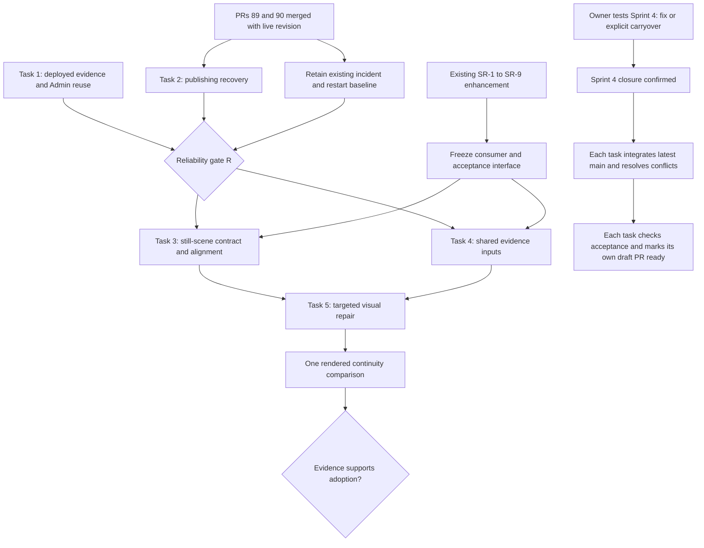

# Sprint 5 Status: Evidence, Recovery and Measured Video Improvements

**Task 1 R4 follow-up, 2026-10-18:** after merged #91/#92, `SPRINT5_TASK1_PUBLISHING_SUMMARY_BE` adds only the actual Task 2 safe-summary Admin/CLI adapter. 116 tests/14 files/zero skips, build/lint/typecheck and whitespace checks pass. [Task 1 report](reports/task1.md) records the separate follow-up and unknown/legacy/security semantics. No schema/writer change, Sprint 4 closure hold, merge or deployment; new summary live readback follows owner deployment.

**Task 2 readiness, 2026-10-18:** #92 integrates merged #91/main `3b0ee91`; 168 tests across 23 files (zero skipped), build/lint/typecheck and fresh upgrade/idempotence/drift checks pass. Owner-run Hostinger results at 10:42 IST verify private backup/full restore, the existing key and all three credentials, and one PM2 fork with no running publishing/runs. Code and rollout preparation are ready for review. The current server has no admission gate and auto-deploy only restarts PM2: execute the [pre-merge gate/drain/final-backup/idle-worker-stop procedure](runbooks/task2-rollout.md) during the owner's deployment window; the handoff itself was not performed. Sprint 4 closure and a real upload are not prerequisites; combined acceptance follows Task 5.

**2026-10-18 owner workflow update:** technically ready PRs may proceed to review before Sprint 4 closure. One combined Sprint 4–5 acceptance pass follows Task 5; this supersedes older closure-before-readiness prose and the historical graph below. Task 1's #92 publishing-summary adapter is a pending, nonblocking follow-up. PR #91 preparation uses branch `review/pr91-merge-ready`, worktree `D:\Study Material\7AI\.worktrees\pr91-merge-ready`; the original task worktree is unchanged. Merge/deployment remains owner-controlled.

**Sprint status**: Planned; Sprint 5 implementation has not started. Five task specifications exist. **Planner PRs #89 and #90 are merged and live-reported deployed; reuse both.** Owner-led Sprint 4 testing/triage/closure is pending. Each Sprint 5 task gets a separate draft PR and remains draft until the closure/conflict-resolution gate passes. The existing Script Review enhancement retains its ownership.
**Last updated**: 2026-10-14, approximately **22:30 IST**. Earlier live snapshots at 20:50/21:22 IST are retained as history; the latest readback reports #90 and a fifth budget-stopped attempt.
**Planning checkout**: `provider-capacity-recovery`, HEAD `ac9a98a30cab3c7fdd367c3864960b7aa5917477`; unchanged. Releases #89/#90 were inspected read-only with `git show`. Other work merged/deployed them; this planning chat made no branch change, commit, merge, deployment, schema/application edit or production run mutation.

## Start here

Read the [task template](../templates/TASK_TEMPLATE.md), then the selected task in `tasks/task[n].md`, [schema delta](SCHEMA.md) and [business-logic contracts](BUSINESS_LOGIC.md). Reports belong in `reports/task[n].md` when implementation actually occurs; no completion reports are fabricated here.

**Read the binding [shared-directory, draft-PR and Sprint 4 closure workflow](WORKFLOW.md).** Task 1's agent creates the one `D:\Study Material\7AI-SPRINT5` root; all agents reuse it with isolated `task[n]` worktrees underneath. One draft PR per task; no umbrella implementation PR. After owner-confirmed Sprint 4 closure, each agent integrates closure fixes/latest main, resolves conflicts, reruns affected checks and marks its own PR ready for review. Nothing is closed or marked ready by this planning update.

**Required sequence:** Task 1 sets up its own branch/worktree, **commits all Sprint 5 planning documents first in a documentation-only commit**, pushes it and opens the Task 1 draft PR; then it proceeds with Task 1. The existing referenced audit Markdown is included if absent from main. Other agents reuse that committed baseline; task implementations remain separate PRs. This planning chat does not commit the documents on the current branch.

The owner supplied five ordered priorities: (1) reconcile the deployed planner; (2) finish reliability; (3) make scene planning match the renderer; (4) share factual evidence and repair only affected components; (5) demonstrate a creative improvement in a rendered comparison. The tasks follow implementation boundaries rather than assigning a fresh task to every audit finding. Task 5 combines targeted visual repair with its first controlled continuity experiment because the experiment is the acceptance proof for that repair path.

### Evidence vocabulary

- **Verified—repository**: code, tests or Git objects inspected; it does not mean the behavior was executed.
- **Verified—live**: an authenticated diagnostic response obtained in this exercise.
- **Reported**: supplied by the owner or an existing report; not independently reproduced here.
- **Inferred**: a supported explanation with its limits stated.
- **Proposed**: future contract, implementation or evaluation criterion.

Every task uses these distinctions. Test commands in task specifications are future acceptance checks. The prior audit's executed checks remain historical evidence, not newly executed Sprint 5 tests.

## Task-creation workflow discovered in Sprint 4

The useful convention is **`sprint[N]/tasks/task[n].md`**, not files directly named `sprint5/task[n]`. Sprint 4 has numbered backend tasks 1–12, separately named `frontend-task[n].md`, matching reports, and `STATUS.md`, `SCHEMA.md`, `BUSINESS_LOGIC.md`, `PENDING.md`. Sprint 5 did not exist when numbering was assigned; nothing was overwritten.

The [shared template](../templates/TASK_TEMPLATE.md) provides Objective, Duration, Depends On, Owning Component and Success Criteria; detailed requirements with acceptance criteria; Schema Impact; Business Logic / State Transition; Implementation; Testing; Report Template; Additional Notes and references. Sprint 4 [Task 1](../sprint4/tasks/task1.md), [Task 9](../sprint4/tasks/task9.md), [Task 10](../sprint4/tasks/task10.md), [Task 12](../sprint4/tasks/task12.md) and their reports were inspected. They use R-numbered requirements, check the actual code before changing it, distinguish fixture-based development from integration, and record deviations and founder actions. Task 10 explicitly excludes SR-1–SR-9 and reports optional scene repair as **not built**. Its implementation report corrects earlier guessed artifact names; specifications must follow current code, not those guesses.

The general template requires each concurrent session to use its own worktree, commit only to a branch it created, record its actual branch immediately, open a draft PR, and leave merging to the founder. Sprint 4 uses per-task branches where concurrency warrants them. Sprint 5 reserves `SPRINT5_TASK[n]_BE` names, preserving that existing naming convention; they are proposals, not branches created here. The user explicitly prohibits Git mutation during planning, so the template's implementation-time branch/commit steps were not executed. Future sessions must check existing ownership before creating anything.

Reports include actual tests, schema applications, source changes, deviations and sign-off. A code-complete report does not establish deployment. Sprint 4's task-specific instruction to avoid broad shared-status rewrites is retained: update only one's own status row, resolve documentation conflicts during integration, and let the integration owner reconcile global status. Never automatically message another chat. Shared schema and state-machine edits have named owners and sequenced integration below; a parallel branch is not permission to edit the same contract independently.

## Current-state reconciliation and audit addendum

This section updates the decisions in the [October 14 audit](../../audits/2026-10-14/7AI-STUDIO-AUDIT.md). The audit is retained as its dated record; its lack of live deployment evidence is superseded only by the specific observations below. Older [global status](../../STATUS.md), [Sprint 4 status](../sprint4/STATUS.md) and [pending page](../sprint4/PENDING.md) are dated October 11 and contain stale “not started” rows. They are not deployment certificates.

| Work | Repository / external evidence | Deployment or remaining boundary | Sprint 5 decision |
|---|---|---|---|
| Sprint 4 profiles, formats, render floor, long-form, previews, packaging, analytics, run-screen data | Source and reports exist; audit E02–E19 detail them | Owner reports all Sprint 4 deployed except Script Review enhancement. Live current server contains later fixes; every old UI journey was not re-tested | Reuse; do not recreate tasks 1–12 |
| Planner batching and partial checkpoints | PR [#87](https://github.com/Neeraj1002/7AI/pull/87) merged 2026-10-14 09:44:57 UTC, merge `ea5bd5f`; `plan-long.ts`, stage integration and tests exist | Included in current live reported commit | Already implemented; no batching/checkpoint rebuild |
| Capacity/spend recovery and complete-plan reuse | PR [#88](https://github.com/Neeraj1002/7AI/pull/88) merged 09:54:06 UTC, merge `6fb911193d65e7480eabc53acc40d315f219dcdf` | Initial live Admin read reported `6fb9111`; that source tree matches the untouched planning checkout. Superseded by #89 in final read | Reuse; historical content-count errors are not provider-capacity stops |
| Planner scene-contract / capped legacy recovery | PR [#89](https://github.com/Neeraj1002/7AI/pull/89) merged 15:25:40 UTC, `b0cfa6b4969842d73d975e47b64640f18307feab`. Git-object inspection confirms strict slots, targeted correction/splitting, checkpoint carry-forward, one-use recovery and per-call diagnostics | At the earlier 15:52 UTC read, server reported `b0cfa6b` and four historical attempts. The later snapshot below supersedes that run state | **Already implemented**; no duplicate count/checkpoint/allowance task |
| Legacy checkpoint hash-order fix | PR [#90](https://github.com/Neeraj1002/7AI/pull/90) merged **22:05:03 IST**, `5b04a7a22b31a8c6562100c72bc157beccd91e62`. Inspected source validates chapters but hashes original persisted objects instead of Zod-reordered objects | Latest live Admin reports **`5b04a7a`**, boot **22:05:46 IST**. Fifth video attempt exists and stopped at the **$1.50 spend limit** | **Already implemented and live-reported deployed**. Retain hash compatibility; Task 1 inspects the new budget stop/assets, not another hash fix |
| SR-1–SR-9 Script Review enhancement | Sprint 4 pending lane D; Task 10 explicitly excludes it; [miss log](../../review_tuning/SCRIPT_REVIEW_MISSES.md) contains six cases. No dedicated enhancement task/report or open PR found in inspected records | Owner confirms outstanding. The current reviewer remains a plausibility check | Keep as existing outstanding work; Task 4 coordinates evidence input and tests, not the rule rewrite |
| Publishing recovery | Publishing/client/stall/resume code inspected; audit R1 describes late receipt and concurrency gaps. #89 changed planner/shared integration, not the upload boundary | Final release source retains the publishing gap; no live duplicate-upload incident reproduced | Verified implementation gap; Task 2 |
| Scene repair | Sprint 4 Task 10 R7 optional; report says not built. Existing caches and chapter render reuse are real | No new repair journey verified | Task 5 builds a bounded visual-only path on those capabilities |

The planner worktree's older reports predate its code/merges. Canonical baseline is now **#89 plus #90**, not copied worktree files. Do not edit/clean/commit that worktree. Future Sprint 5 branches start from current main containing `5b04a7a` or a verified descendant, and check newer ownership first. Shared-directory/worktree and per-task PR mechanics are in [WORKFLOW](WORKFLOW.md).

### Latest #90 reconciliation — supersedes the parked-run snapshot below

**Verified—GitHub/source:** #90 changes `legacy-planner-recovery.ts` and its regression test. The prior validator reconstructed chapter objects in `title,text` property order; the legacy hash had used persisted JSONB `text,title` order. `JSON.stringify` preserves property order, so unchanged chapters could fail hash equality. The fix validates shape while passing original stored objects to hash/checkpoint matching. This is a precise compatibility repair already delivered; no Sprint 5 reimplementation.

**Reported—release tests:** 54 focused tests across three files plus Studio typecheck/build/lint passed, with no provider generation/production write by that PR's author. These are not tests executed by this planning chat.

**Verified—live:** latest system response reports `5b04a7a`, production, boot `2026-10-14T16:35:46.101Z` (22:05:46 IST). The same run remains needs-attention/video-generation, now with attempt **5**, started **22:17:22 IST**, ended **22:28:06 IST**. Its latest error is: “Spend limit reached: this video has used $1.50 of its $1.50 limit…” No bundle is listed. This chat only read the state; it did not start that attempt or raise the budget.

**Inference:** legacy Retry is no longer merely the unchanged four-attempt case; another attempt progressed until a budget stop. The stop does not prove that the complete plan/render or every retained asset is valid. The current API still cannot expose all checkpoint/recovery/asset summaries.

**Proposal:** Task 1 documents the distinct #90 hash fix, current spend-limit classification and available retained-work evidence through existing diagnostics. Reuse budget recovery and preserve limits. Do not reset the legacy allowance/counters, create a new hash-repair task, raise spend or retry as part of diagnosis. Successful completed video/restart recovery remains unverified.

### Live failed-run evidence

The owner authorized using an existing production diagnostic credential. It was read locally without printing it. Requests went only to `https://7aistudio.tech`; redirects were rejected and each request had a 12-second timeout. No provider generation, retry, force action or approval was invoked. Three `admin.runs.content` views created the API's normal access-audit rows; business data, counters, run states and assets were unchanged.

`admin.system.info` initially returned HTTP 200: commit **`6fb9111`**, production, boot `2026-10-14T09:54:44.661Z`. **Final readback returned `b0cfa6b`, production, boot `2026-10-14T15:26:47.909Z`**. Both reported media/stock/image stubs false and R2/OpenAI/YouTube OAuth presence flags true. The newer boot follows #89's 15:25:40 merge and corroborates release deployment. `resolveCommit()` prefers `GIT_COMMIT`, otherwise caches a checkout `git rev-parse` result on first read: useful evidence, not immutable compiled-artifact provenance for every historical attempt. Task 1 preserves that limit; `/health` alone exposes no revision.

`admin.runs.get({runId: "dbf432ff-4d67-4cf7-a143-73d8c7553cc7"})` returned HTTP 200: `needs_attention`, `video_generation`, latest error requesting exactly 12 scenes but receiving 13 in chapter 2. Gate 1 was approved. There are no listed debug-bundle attempts.

| Video-generation attempt | Live timing UTC | Live result | Retained evidence / limit |
|---|---|---|---|
| 1 | 04:20:46–04:21:50 | Chapter 1 output cutoff at 8,192 | No checkpoint key in output; historical deployed SHA unknown |
| 2 | 04:23:29–04:26:29 | Chapter 3 output cutoff at 8,192 | No checkpoint key in output; historical deployed SHA unknown |
| 3 | 09:56:05–09:59:10 | Chapter 2 count failure twice | Audited content: first **14**, final **13**, request 12; both `stopReason: stop`; final original length 8,962, raw reply truncated. Output key names include checkpoint and recovery |
| 4 | 10:01:46–10:03:08 | Chapter 2 count failure twice | Audited content: first **13**, final **13**, request 12; both normal `stop`; final original length 8,777, raw reply truncated. Output key names include checkpoint and recovery |

Approved chapter word counts from live Gate 1 content are **326 / 284 / 281 / 288**. The existing worktree investigation reports an eight-minute target, five seconds per still, **96** total slots allocated **27 / 23 / 23 / 23**, three used manual video retries, **27 accepted scenes** in attempts 3/4 with matching hash `813c20a235e4c512828fce049e0955c87e5686ddfcc1f4c53bd0c45ea4889438`, and null recovery markers. Those checkpoint values and retry count are **reported from owner-supplied database results**, not independently returned by the current Admin API. Live usage shows 1 / 3 / 5 / 2 planner events per attempt, 11 total, **$0.5169** summed from rounded rows, with empty metadata-key lists. The full run has 16 usage events, about **$0.8710** total recorded cost. Token columns are not exposed by this route today; their values in the investigation remain reported.

**Verified root cause under the pre-#89 contract used by the recorded failures:** the model-facing schema accepted a nonempty array; exact count/anchor validation occurred afterward. Generic correction regenerated without the rejected reply and repeated overproduction. Capacity eligibility did not cover this normal-stop content error. **#89 now addresses this chain** with strict fixed-property IDs, locally assigned narration spans/anchors, one targeted correction followed by decreasing-scope splitting, validated legacy checkpoint carry-forward and atomic one-use legacy recovery. Its reported 110 focused tests plus build/lint/typecheck are release evidence, not tests rerun in planning. No failure of that new recovery is evidenced: the live run remains parked without a new attempt. Do not diagnose the old error as a failed #89 execution.

**Inference:** matched reported checkpoints plus five calls in attempt 3 and two in attempt 4 support reuse of accepted chapter 1 work. “Recovery did nothing” would overstate the evidence. Partial reuse did not overcome the later chapter 2 count error, and the reported ordinary manual cap then limited further attempts. Exactly which original prompt instruction caused the extra beat is unproven. Full response tails were capped at 8,000 characters and cannot be reconstructed. No complete plan, images or final video for this run are evidenced; no claim of downstream visual failure is made from it.

**Historical conclusion at the earlier snapshot:** #89 implemented finite recovery, but the run had not yet attempted it. #90 and the fifth attempt above supersede that observation. Task 1 reuses both releases and budget recovery; it adds no allowance/hash fix and triggers no paid recovery. Complete production success remains unverified.

## Admin API reuse: the missing capability is response detail and workflow exposure

| Existing capability | What it supplies | Boundary / decision |
|---|---|---|
| `admin.system.info` | Revision, boot, uptime, boolean provider/storage/stub flags | **Invoked successfully**. Reuse for deployment reconciliation; no new health/revision endpoint |
| `admin.runs.get` | Cross-tenant run structure, all stage attempts/times/reasons/output key names, usage costs/model names/metadata key names, gate outcomes, bundle availability | **Invoked successfully**. No raw input/content, token counts, option values or checkpoint summaries. `profileVersionId` is currently hardcoded null despite the real column |
| `admin.runs.content` | Audited brief, completed stage output, bounded failed-stage diagnostics, bundle manifests, short-lived manifest-bound file links | **Invoked successfully**. Admin audit must succeed before content leaves. Failed-stage allowlist strips checkpoints, recovery and newer diagnostics; raw replies are intentionally forbidden |
| Tenant `runs.get`, `runs.progress`, `runs.getAttemptBundle`, `runs.getVideoUrl` | Own-tenant script/review/artifacts/progress and media links | Reuse in product; ops-token tenant context is the MVP tenant, so do not use it to bypass tenancy or impersonate this run's owner |
| Admin UI run inspector | Calls `get`; content fetched only after explicit tap, held transiently | Existing human fallback; new UI is unnecessary for the first diagnostic CLI |
| `scripts/dry-run.ts status` | Database-backed local/server inspection | Existing fallback only if API cannot supply needed evidence. Never invoke `setup`, `resume`, `publish` or other mutating subcommands for diagnosis |

Authentication is the existing bearer session or `API_AUTH_TOKEN` ops fallback. `adminProcedure` accepts the ops actor or freshly checks `isPlatformAdmin`; a tenant owner is insufficient. No credential is needed in task documents or chat. The current ops credential is broad, so the diagnostic client must have a hardcoded allowlist of read operations, not arbitrary procedure names. A new credential system or unrestricted SQL gateway is unnecessary for this sprint.

Task 1 extends bounded diagnostic projections in these routes and adds one repeatable client/runbook. It must distinguish **not persisted**, **not exposed**, **truncated**, **unavailable**, and **not applicable**. **#89 already persists new per-call diagnostics; Task 1 adapts those fields instead of implementing another persistence writer.** A new endpoint is justified only if the existing projection cannot carry the agreed contract; that deviation requires evidence and coordination. Publishing status later uses Task 2's safe receipt projection. No full provider body, raw rejected model reply, session URI, unrelated tenant records or signed URL is returned by default.

## Ordered priority coverage and disposition

| Priority | Existing coverage | New work / disposition | Evidence and testable benefit |
|---|---|---|---|
| **1. Deployed planner reconciliation** | #87/#88 plus **#89 contract recovery and #90 hash compatibility**, merged/live-reported deployed | **Task 1 P0**, diagnostics and current retained-work/budget-stop evidence; no duplicate planner/count/hash/allowance task | Latest `5b04a7a`, fifth attempt stopped at $1.50; older attempts show cap/count errors. Exact new retained components remain unavailable through current projection |
| **2. Reliability before features** | Narrow pre-send upload retry classification; late ID checkpoint; restart harness; budgets/cancellation | **Task 2 P0**, receipt/ownership/resumable upload lifecycle. No separate quota/cache platform rewrite | Same deployed source tree: checkpoint follows R2/thumbnail/captions; stall race leaves upload alive; reuse only finds running receipt. Fault tests must prove no new insert under unresolved outcome |
| **3. Renderer-compatible planning** | AI stills + FFmpeg pan/zoom; **#89 supplies deterministic slot narration spans**; existing timeline/frame allocation | **Task 3 P1**, after reliability gate. Reuse #89 slots/spans; persist meaning/actual alignment, not a second count planner | #89 still contains moving-video directions; renderer matches only three anchor tokens/interpolates misses. Tests map repeated phrases/assets to the correct existing spans |
| **4. Evidence + safe affected-component repair** | Raw brief, explicit source strings, fact policy, review concerns UI; existing SR work; still/narration/chapter caches | **Task 4 P1** owns evidence plumbing; **Task 5 P1** owns visual-only repair. SR-1–SR-9 stays outstanding. Full script/audio dependency repair deferred | Writer only appends sources for long; reviewer has no source input; long report records inventions. Optional Task 10 R7 absent. Packet equality and real asset/call counts demonstrate improvement |
| **5. Rendered creative proof** | Technical QC, preview output, historical continuity sample, licensed beds | **Task 5 experiment gate**: one controlled continuity repair, baseline versus variant. Graphics, motion-generation and sound-cue expansions deferred | Blind comparison of the exact affected span, fixed audio/script/timing, artifact hashes, technical QC and actual incremental cost; no retention claim from a single comparison |

## Candidate triage beyond the five priorities

Frequency estimates are unavailable unless a report contains a corpus. One confirmed planner run is not a fleet frequency measurement; the publishing gap is severe because it creates an external side effect, but no duplicate incident was reproduced.

| Candidate / audit recommendation | Classification | Severity / value / effort / validation | Decision |
|---|---|---|---|
| Planner output cap, exact count and retained batch recovery | Already implemented; live incident recovery not exercised | Historical observed failure; #87/#88/#89 cover bounded/capacity/count lifecycle. Tests and live diagnostics support remaining evidence work | Reuse #89 + Task 1, not a second planner task |
| Provider quota/retry bookkeeping | Existing capability; #89 aligns displayed/enforced eligibility | Limits distinguish provider/spend failures; ordinary counters and one-use legacy exception already implemented | Reuse; no new quota model, allowance or infinite retry setting |
| Upload receipt, overlapping attempts, ambiguous outcome | Verified gap; production frequency unknown | High potential external impact; 3–4 implementation days plus sign-off; process/concurrency fault tests | Task 2, mandatory reliability gate |
| Whole cache/billing/distributed-workflow rewrite | Needs investigation | Crash windows exist; no incident establishes all proposed mechanisms are required | Defer broad rewrite; only integrity checks required by Task 5 and publish ownership in Task 2 |
| Rendered quality floor / long hold check | Already implemented; needs live editorial evaluation | Technical metrics and long pacing checks exist; midpoint sampling cannot prove scene-by-scene accuracy | Reuse in Task 5; no duplicate QC service |
| Factual grounding | Verified input asymmetry; pending reviewer overlap | Real misses reported, source input mismatch verified. 1–2 days after interface coordination | Task 4; research retrieval remains separate policy unless existing SR work explicitly owns it |
| Scene-local repair | Verified missing integration over existing caches | Saves valid media and permits controlled visual correction. 2–3 days after scene identity contract | Task 5, visual-only scope |
| Broad semantic beat planner / many modalities | Improvement hypothesis | No comparative output proves added architecture; overlaps count fix and repair | Defer beyond explicit purpose/span contract and one continuity trial |
| Narration mood, SFX/cues, explanatory graphics | Opportunity; current mastering already works | Sample measured −14.1 LUFS; naturalness not listened to here. Each feature requires a different comparison | Defer production expansion; choose only continuity for this sprint's trial |
| Speech/ASR compatibility and service retirement | Verified code/documentation risk in audit R7 | Lifecycle deadlines justify a separate provider migration assessment, not artistic fashion | Track after immediate incident/publishing closure; do not casually swap registry names or invent a new agent. Audit documents Jan 6 / Feb 26, 2027 retirement dates and alignment risks |
| Niche presets/category settings | Existing versioned profiles; creative effect unproven | Profiles already consume guide/style/audio/packaging/format fields | Defer new settings/category engine; reuse one existing profile in trial |
| Autonomous learning, trend/competitor fleet, multiple new models | Speculative future work | No measured incremental video value; analytics access/retention data still limited | Deferred; no new agents or models |
| Storage mapping, security/licensing attestation | Needs deployment evidence / existing controls | Audit flags path mapping and license provenance, not a confirmed production misconfiguration | Record evidence if encountered; no `data` or `deploy.sh` cleanup, tracking or changes |

## Task matrix and ownership

| Task | Objective / priority | Depends on / start condition | Parallel group | Primary ownership / expected output |
|---|---|---|---|---|
| [1](tasks/task1.md) | Planner reconciliation + repeatable diagnostics, **P0** | First agent establishes shared Sprint 5 root/plan baseline; fresh main includes #90 | **A** | Admin readers/client; bounded current run evidence; its own draft PR |
| [2](tasks/task2.md) | Durable publishing and safe upload recovery, **P0** | Reuse established root with own task worktree, main includes #90; rollout review remains | **A** | Publishing/receipt/CAS/migration; its own draft PR |
| [3](tasks/task3.md) | Still-scene purpose and narration/asset alignment, **P1** | Reliability gate R; retain #89 contract; reviewer owner agrees production-description wording boundary | **B** | Still plan/scene contract, anchor mapping, video reviewer production contract; truthful prompts and verifiable mapping |
| [4](tasks/task4.md) | Identical evidence for writer/reviewer, **P1** | #91/#92/#93 final merges and gate R for release; consumer v1 development authorized | **D** | Draft #94 implements packet, shared writer/reviewer evidence and snapshot plumbing; reviewer rules stay in SR lane |
| [5](tasks/task5.md) | Safe single-scene repair + one continuity comparison, **P1** | Tasks 3/4 integrated and SR baseline agreed; R stays satisfied; review/repair eligibility contract signed off | **C** | Repair orchestration and receipts, existing media cache/render integration, offline comparison harness and results |

**Gate R** = Task 1 establishes historical versus current failures/retained work and supplies sufficient diagnostics; #89/#90's existing incident/restart/hash compatibility is retained; Task 2 passes publishing fault/concurrency checks and is integrated. Latest live evidence shows a fifth attempt stopped by budget, **not a completed recovered video**. This gate authorizes no paid continuation or limit change. Tasks 3–5 feature implementation waits for R; reading/fixture preparation can precede it. Separately, every task PR stays draft until the owner closes Sprint 4 and the WORKFLOW conflict/acceptance gate passes.

Tasks 1/2 can work concurrently **after Task 1 establishes the root, commits/pushes the documentation baseline and opens its draft PR**, each in its task worktree under that same root, starting from main containing #90. Preserve #89/#90. Tasks 3/4 have distinct core modules after R, with shared integrations sequenced; Task 5 follows both. Every task has a separate draft PR. Owner-led Sprint 4 testing can run while drafts are prepared; [the closure gate](WORKFLOW.md) controls ready-for-review, not just code completion.

### Shared-file rules and integration sequence

1. #89/#90 are merged/live-reported deployed. Task 1 creates the one Sprint 5 root; all task branches/worktrees reuse it and start from current main containing `5b04a7a` or a descendant. No task duplicates count recovery, legacy allowance or hash-order fix. Check newer ownership before edits; do not switch this planning checkout.
2. Task 2 integrates publishing changes only after that shared-file baseline. It exclusively owns the proposed `PipelineRun.publishingRecovery` migration and repository CAS/lease operations; no other Sprint 5 task modifies Prisma schema or migration files. Task 1 consumes a safe publishing-summary function exported by Task 2 through its own Admin adapter, after Task 2 lands.
3. After R, Task 3 integrates scene schemas/render and agreed production-wording changes. It does not edit factual/scoring rules. Task 4 integrates evidence plumbing afterward in shared call sites; its separate evidence module/writer work can be developed concurrently with Task 3.
4. The existing SR owner owns `script-review/index.ts` factual rules/output rubric and any search-grounded verification decision. Task 4 owns new evidence input plumbing; one agreed reviewer patch is landed by the SR owner or after an explicit ownership handoff. Task 3's production-wording change is similarly handed to that owner if the file is still active. No two agents independently patch it.
5. Task 5 integrates last. It owns visual repair call sites and returns to existing video review/Gate 2. It does not alter upload ownership, manual cap policy or SR rules.
6. Integration owner resolves task-row documentation conflicts, updates only the actual delta in SCHEMA/BUSINESS_LOGIC, runs interaction tests (scene mapping→repair, evidence change→invalidation, retry→publishing receipt), and records exact final commits. No whole-repository reset, copied implementation from another worktree, or automatic merge.

## Approval and production boundaries

These are specifications, not approvals to execute external side effects. Founder merging is required; `.github/workflows/deploy.yml` auto-deploys pushes to `main`, so **merge is also a production deployment boundary**. Do not treat a draft PR as authorization to deploy. Task 2's persistence/workflow migration needs concrete review, backup and compatibility checks before application/rollout. #89 already implements its one-time legacy retry policy; this plan neither adds another allowance nor authorizes using it on the parked production run.

Live reads require an existing approved Admin session/diagnostic credential. Use only allowlisted APIs, bound output, sanitize exports and retain normal access auditing. No SQL gateway, credential provisioning, force/retry/approval/cancel action, paid generation or public upload belongs in diagnostic reads. SQL SELECT is a fallback only when no authorized API/retained artifact can supply the missing data. Missing deleted/truncated text is recorded as unavailable, never obtained by regenerating production work.

Future rendered trials default to existing approved, licensed local fixtures with a stub provider and no publish step. Real image replacement/TTS/LLM calls, a live restart, an upload or a production retry require an explicit agreed run/channel/spend/visibility plan. Do not restart the entire service to test a fixture or awaken unrelated runs. Never remove, track or modify Hostinger's untracked `data` and `deploy.sh`; no cleaning untracked local worktrees either.

## Status tracker

| Task | Name | Status | Owner | Branch | Notes |
|---|---|---|---|---|---|
| 1 | Planner reconciliation and run diagnostics | In Progress | Codex | SPRINT5_TASK1_PUBLISHING_SUMMARY_BE | Small R4 follow-up after merged #91/#92; worktree D:\Study Material\7AI\.worktrees\task1-publishing-summary; current-main base 6464f9cecd3b5b65df8f31a4712b4119749cecc2. Add only Task 2's safe publishing-summary Admin adapter and focused compatibility/security coverage. Separate PR; revised workflow has no Sprint 4 closure hold. |
| 2 | Durable publishing recovery | Done - action needed | Founder | review/pr92-merge-ready | Ready-for-review PR #92 (SPRINT5_TASK2_BE); preparation worktree D:\Study Material\7AI\.worktrees\pr92-merge-ready. Main 3b0ee91 integrated; 168 tests/23 files/0 skipped, build/lint/typecheck and migration upgrade/idempotence/drift pass. Owner-run 10:42 IST evidence: private backup/full restore verified, existing key and 3 credentials valid, one PM2 fork, no active runs/uploads. Owner must perform the documented pre-merge admission gate, final drain/backup and idle-worker stop; no deploy/config change/upload performed here. Combined acceptance follows Task 5; Task 1 Admin summary adapter remains a nonblocking post-#92 follow-up. |
| 3 | Still-scene contract and alignment | Implemented; ready for review | Codex | `SPRINT5_TASK3_BE` | Rebased onto main and retargeted from temporary `SPRINT5_TASK3_DEPS` base. Still-capability wording (7c6ef3c), scene mapping and local FFmpeg acceptance implemented and tested; no Sprint 4 closure or reliability-development blocker. Combined Sprint 4–5 acceptance follows Task 5. See Task 3 report. |
| 4 | Shared factual evidence inputs | Implemented; ready for review | Codex | `SPRINT5_TASK4_BE` | Retargeted from the temporary `SPRINT5_TASK4_DEPS` base to main after #91/#92/#93 merged. Evidence consumer v1 (`factualBaseline`) is documented for Task 5 in the Task 4 report. Evidence-only scope: no SR-1–SR-9 rules, retrieval, models or settings. No Sprint 4 closure hold; combined Sprint 4–5 acceptance follows Task 5. |
| 5 | Visual repair and continuity comparison | Implemented; ready for review | Codex | `SPRINT5_TASK5_BE` | Integrated with main (Tasks 1–4 merged) in `review/pr95-merge-ready`; retargeted from `SPRINT5_TASK5_DEPS`. One-scene visual-only repair, durable receipts, stale-baseline rejection and renewed review/Gate 2 implemented; mocked tests plus a synthetic local A/B render. Creative adoption inconclusive. See Task 5 report. Combined Sprint 4–5 acceptance follows; no Sprint 4 closure hold. |
| 6 | Script Review SR-1 to SR-9 | Draft (R5 failed) | Codex | SPRINT5_TASK6_BE | [PR #105](https://github.com/Neeraj1002/7AI/pull/105); current main 6852fa5, no conflicts; build/lint/typecheck and 991 tests pass (9 skipped). Real-model R5 misses recorded claims, flags/rejects a clean Short and produced invalid JSON. Combined Sprint 4-5 acceptance after Task 5; no closure/upload hold. Not merged/deployed. |

Do not fill Branch with a planned name as if it exists. A future implementer records its actual created branch and worktree in its own row immediately. Code-complete, merged, deployed and live-verified are separate statements in reports.

**Shared root**: `D:\Study Material\7AI-SPRINT5`, created by this Task 1 Codex session. **Setup owner**: Task 1 Codex. **Plan-baseline commit**: `578ba530100638548a4a49af57efcb14e7962227` (documentation only, pushed). **Task PRs**: Task 1 ready-for-review [#91](https://github.com/Neeraj1002/7AI/pull/91). **Acceptance**: one combined Sprint 4?5 pass after Task 5; Sprint 4 closure no longer gates #91 readiness.

## Remaining uncertainties and implementation readiness

- Full original response tails, historical SHAs for early attempts, full requests/provider IDs and per-call metadata were not generally persisted. They cannot be recovered by an API extension. An immutable compiled-artifact revision is not currently exposed. Task 1 can start; its report must preserve these limits.
- #89/#90 revisions/contracts are known; their 110/54-test release results are reported. A fifth production attempt is now visible and budget-stopped, without complete asset/checkpoint evidence. Task 1 must distinguish that stop from older cap/count errors; no new planner fix is justified by the present spend refusal alone.
- Owner testing determines which Sprint 4 bugs remain and which are fully covered by Sprint 5. No specific issue is marked fixed/transferred/closed by this plan. Carryovers require exact task/criterion, owner and remaining test; the original issue remains open until verified. Sprint 5 PRs cannot become ready until closure/latest-main integration/conflict checks pass.
- Task 4's evidence-consumer v1 interface and narrow reviewer adapter were explicitly adopted by the owner. Draft #94 implements them after Task 3's production wording. SR-1–SR-9 rule/accuracy work and owner-confirmed Sprint 4 closure remain separate release conditions.
- Publishing gap frequency is unknown; no live upload was triggered. Task 2 must prove behavior with a fake provider and sandbox concurrency, including the receipt-write failure after successful upload. Proposed migration and transition contract are reviewable below; rollout approval is outstanding.
- Creative benefit, actual production cache integrity and safe visibility/spend for any paid comparison are unproven. Task 5 can run offline once prerequisites land; adopting the experiment requires the stated comparison, not a new model or configuration toggle.

## Planning validation

The planning review checked conventions/source/schema/test names, history/PRs, worktree reports and live Admin responses. Initial `6fb9111` comparison was unchanged; #89/#90 Git objects/file lists were read without changing this checkout. Latest live response reports `5b04a7a` and a fifth budget-stopped attempt. No Sprint 5 application tests were run/claimed passing. Prior audit: 154/155 selected tests/typecheck; #89 report: 110 focused tests/build/lint/typecheck; #90 report: 54 focused tests/build/lint/typecheck. These remain prior/reported results. The owner clarification added one shared root, separate task drafts and Sprint 4 closure/conflict readiness gate; no bug or sprint was automatically closed.

Each task has evidence/inference/proposal, real sources, reuse/scope, contracts, migration/security notes, acceptance/definition of done, ownership/report/Git instructions and uncertainties. Updated document validation checked **9 files, 121 local links and 75 required-section checks, with no missing targets/sections**. Source test names were checked. Only Sprint 5 planning files were written; application/schema/production state and planning HEAD were not changed by this chat.
